# Exercise 1 - Set Up Your SAP Integration Suite, advanced event mesh (AEM) Queue and Topic Subscription
In this exercise, you will create a queue in SAP Integration Suite, advanced event mesh (AEM) and subscribe it to your dedicated new hire topic — so your agent can receive **NEWHIRE** events from SAP SuccessFactors in real-time.

⏱ **Estimated time: 10 minutes**

## Overview

SAP Integration Suite, advanced event mesh (AEM) is the event backbone that connects SAP SuccessFactors to your AI agent. When a new hire completes onboarding in SAP SuccessFactors, a **NEWHIRE** event is published to a topic dedicated to each participant. Your agent needs a dedicated queue subscribed to that topic to receive and process the event.

Each participant needs to create a queue and subscribe to their dedicated topic. This queue will be used in Exercise 7 when configuring and running the AI agent.

## Exercise 1.1 - Create a queue and subscribe to the dedicated new hire topic in AEM

1. Log on to [AEM](https://url.sap/hu5r93) tenant using the user ID and password that is already provided by the instructors.
    For login, use the participant number that is assigned to you.
	
	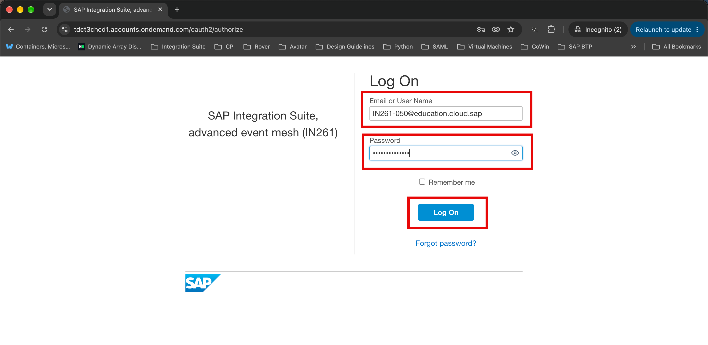
        
2. Click **Cluster Manager** in the left navigation menu on the landing page.

   
   
3. In the **Cluster Manager: Services** screen, click on the **TechEd2026-IN261** tile.
   >**HINT:** If you cannot see the tile, uncheck the **"Only show my services"** checkbox.

	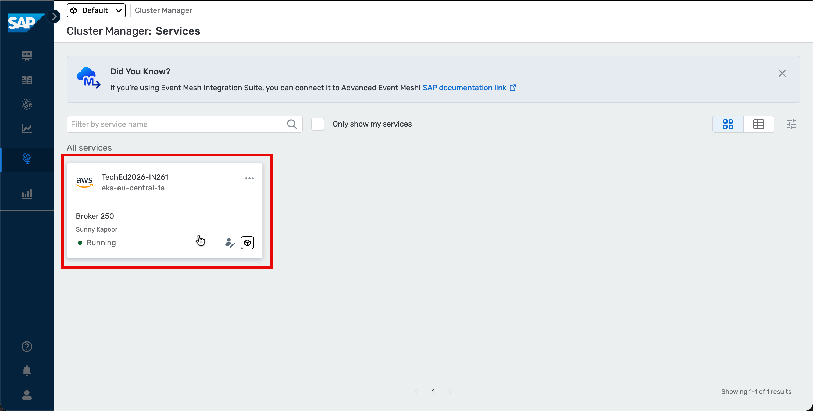

4. Switch to the **Manage** tab.
	
	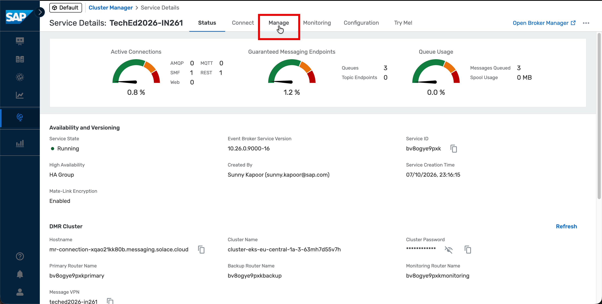

5. Click on the **Queues** link on the left panel.

	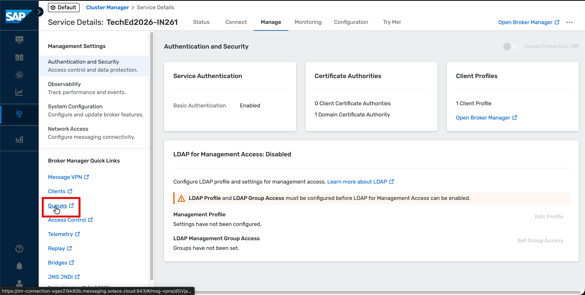

6. A new browser tab will open, listing all the available queues. Click the **+ Queue** button on the top right to create a queue.
   >**HINT:** You will be able to see the queues created by other participants as well.
	
	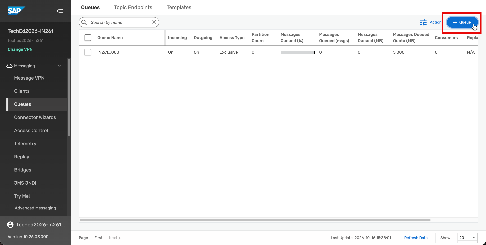    

7. In the pop up, enter the queue name: <b>IN261_0**</b> *(replace ** with the participant number that is assigned to you)* and click on the **Create** button.

	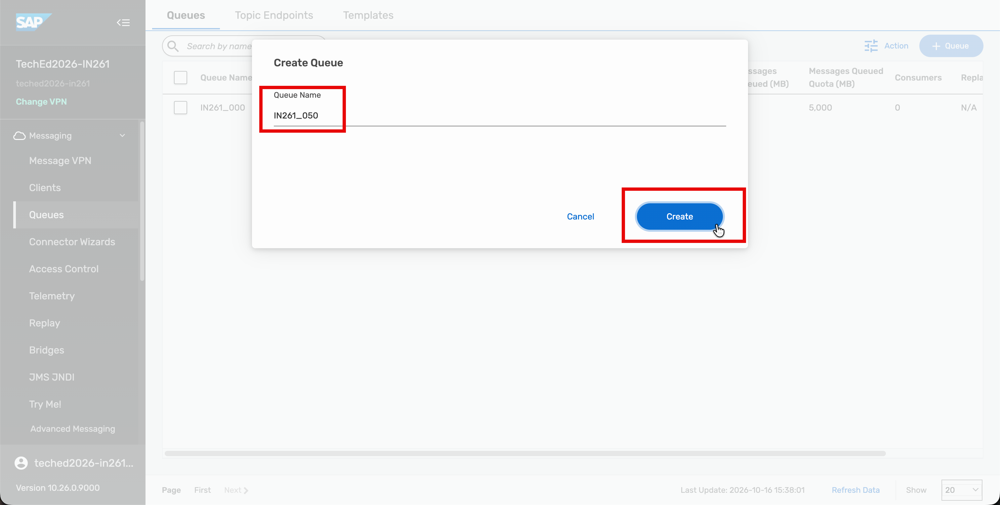     

8. On the next screen, leave the configurations at their default settings and click on the **Apply** button.
	
	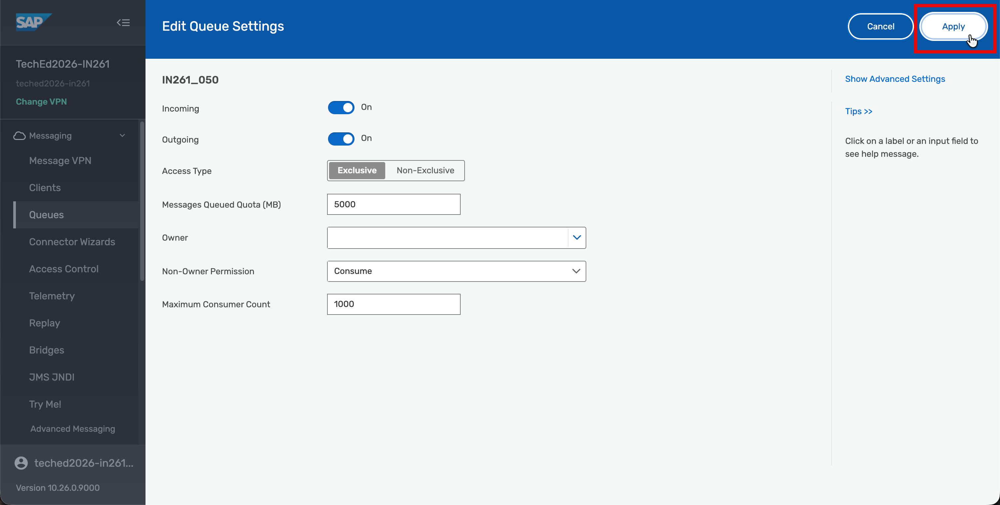     

9. Select and open the queue that you have just created i.e., <b>IN261_0**</b> *(replace ** with the participant number that is assigned to you)*

	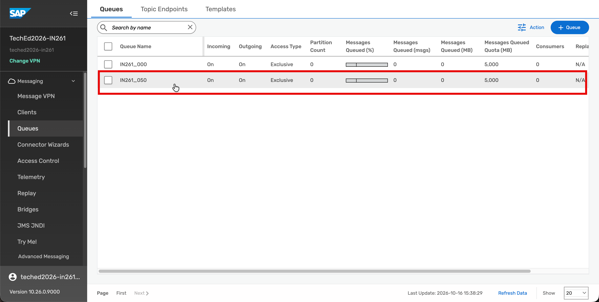   
   
10. Switch to the **Subscriptions** tab.

    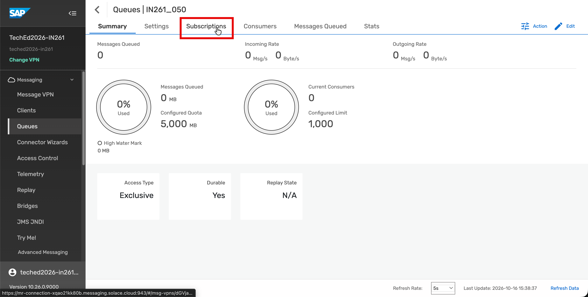   

11. Click on the **+ Subscription** on the top right area to create a new topic subscription.

	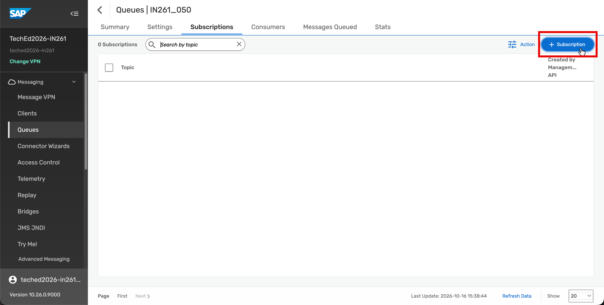  

12. In the pop up, enter the topic: <b>"sap/sfsf/newhire/TechEd_IN261_0**"</b>  *(replace ** with the participant number that is assigned to you)* and click on the **Create** button.
    >**HINT:** Each participant will have their own topic, dynamically created by SAP SuccessFactors based on the new hire's employee ID.

    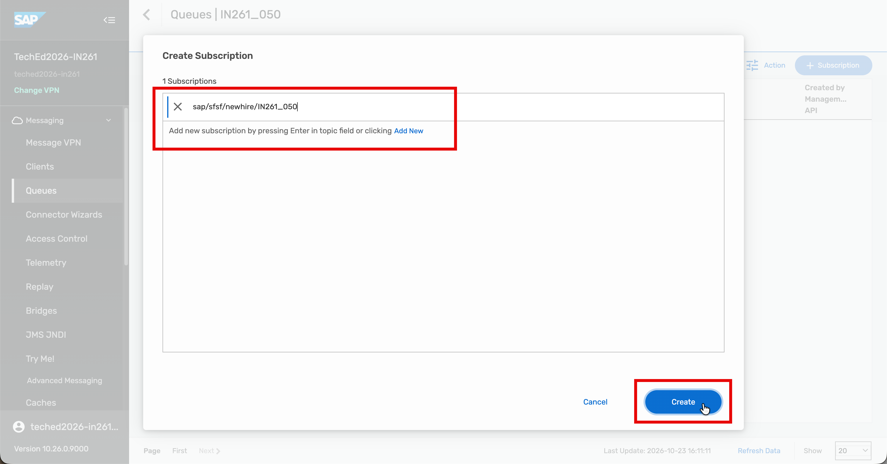

13. Verify that your newly created topic subscription <b>"sap/sfsf/newhire/TechEd_IN261_0**"</b> appears in the list.

	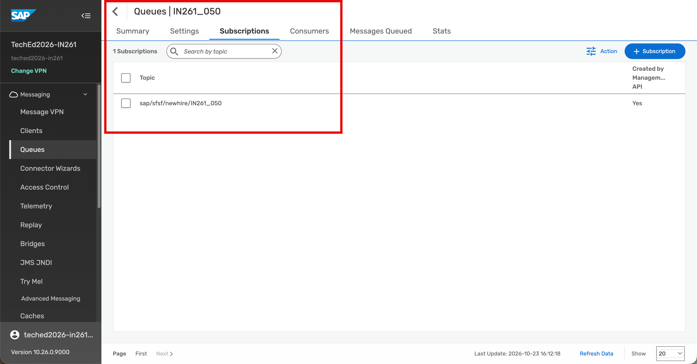

## Summary

At the end of this exercise, you have created your personal AEM queue and subscribed it to your dedicated new hire event topic. With this in place, your agent will receive **NEWHIRE** events from SAP SuccessFactors in real-time as they happen.

Continue to - [Exercise 2 - Create, Configure and Deploy an MCP Server for New Hire Employee Profile Lookup using SAP API Composition](../ex2/README.md)
