# Exercise 3 — Create, Configure and Deploy an MCP Server for HR Policy Lookup using SAP AI Launchpad Orchestration with Document Grounding
In this exercise, you will add a second MCP Server to your existing Integration Package — backed by a pre-configured Integration Flow that connects to SAP AI Launchpad Orchestration Document Grounding to retrieve HR policies for equipment, system access and training enrollment relevant to the new hire's role and location.

⏱ **Estimated time: 10 minutes**

## Overview
When a new hire joins, the agent needs to determine what equipment, system access and training enrollment applies — based on their role and location. This information lives in HR policy documents that cannot be queried directly by an AI agent.

**SAP AI Launchpad Orchestration with Document Grounding** solves this by indexing HR policy documents into a vector store and exposing a semantic search API — so the agent can retrieve the most relevant policies in real-time. A pre-configured Integration Flow acts as the governed middleware between the MCP Server and the Document Grounding API.

In this exercise, you will add a second MCP Server to your existing Integration Package, configure it with the iFlow's OpenAPI specification and authentication policy, and deploy it to the Integration Cell.

By the end, you will have a deployed MCP Server that gives the onboarding agent governed, real-time access to HR policies — ready to be consumed alongside the Employee Lookup MCP from Exercise 2.

<details>
<summary><strong>📖 Pre-Configured: Integration Flow for HR Policy Lookup</strong></summary>

<br>

A **pre-configured Integration Flow (Prompt to HR Policy RAG Pipeline using SAP AI Core)** has been configured and deployed for this session. It acts as the governed middleware between the MCP Server and the SAP AI Launchpad Orchestration Document Grounding API:

- Receives the policy query from the MCP tool call
- Handles the API structure mapping and forwards the request to the SAP AI Launchpad Orchestration Document Grounding API
- Extracts and structures the relevant HR policy content from the Orchestration API response
- Returns the policy content back to the agent

Instead of building this integration flow from scratch, you will use this pre-configured integration flow as the data source for your MCP Server — it comes with an **OpenAPI Specification** and a **Destination** that you will use when creating the MCP artifact in the next steps.

> **Note:** For a deeper understanding, refer to [SAP AI Launchpad Document Grounding](https://help.sap.com/docs/sap-ai-launchpad)

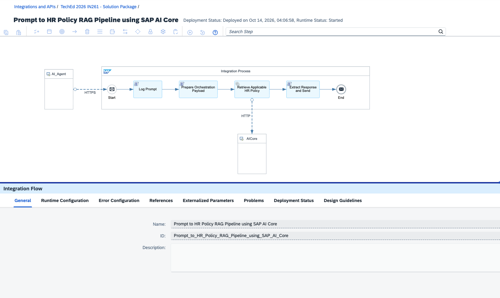
</details>

## Exercise 3.1 — Open your Existing Integration Package

> [!NOTE]
> This exercise builds on the same Integration Package created in [Exercise 2](../ex2/README.md). You will add a new MCP Server artifact to the existing package — no need to create a new one.

1. In SAP Integration Suite tenant, navigate to **Design → Integrations and APIs**, search for and open your package <b>IN261_0**_TechEd_2026_Package</b> *(replace ** with the participant number assigned to you)*.

   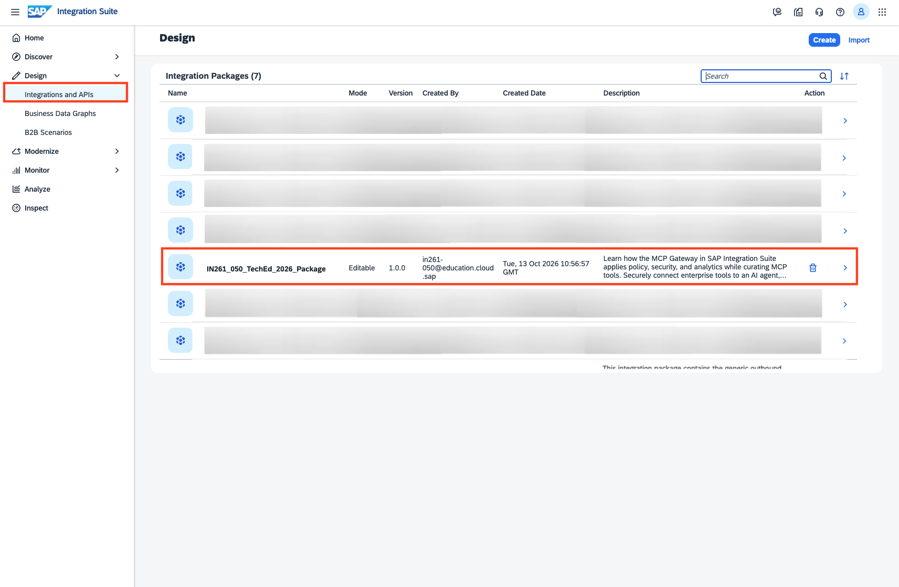

2. Click **Edit** (top right) to enter edit mode. The <b>IN261_0**_Employee_Lookup_MCP</b> artifact from Exercise 2 will already be visible — you will add the HR Policy MCP Server alongside it.

   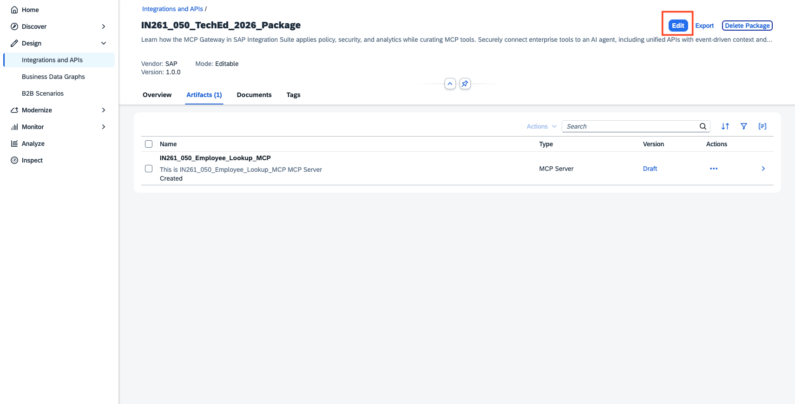

## Exercise 3.2 — Create the MCP Server Artifact

1. Go to the **Artifacts** tab, click **Add** and select **MCP Server** from the dropdown.

   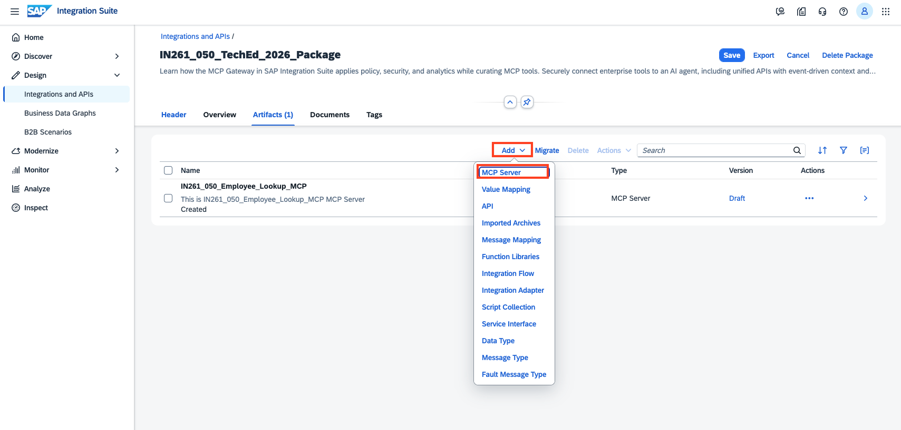 

2. In the **Add MCP Server** dialog, select **HTTP Endpoint with OpenAPI Specification** as the source type and click **Next**.

   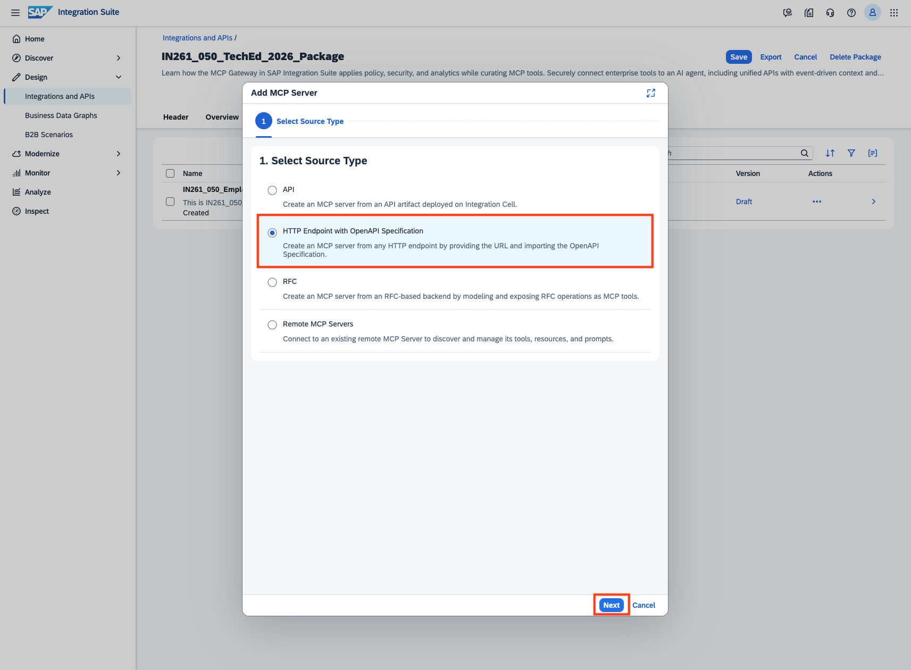

3. Download the OpenAPI Specification: [`Company_Policy_RAG_API.json`](https://github.com/SAP-samples/teched2026-IN261/releases/download/exercise-assets/Company_Policy_RAG_API.json) — you will upload it in the next step.

4. Fill in the MCP Server details:

   | Field | Value |
   |---|---|
   | Method | `Upload` |
   | File Name | Upload the `Company_Policy_RAG_API.json` downloaded in the previous step |
   | Source | `Destination` |
   | Destination | Select `in261_iflow_as_mcp` from the destination list |
   | Relative URL | `/http` |
   | Name | <b>IN261_0**_HR_Policy_Lookup_MCP</b> *(replace ** with the participant number that is assigned to you)* |
   | ID | Auto populated |
   | MCP Path | <b>/in261_0**_hr_policy_lookup_mcp</b> *(replace ** with the participant number that is assigned to you)* |
   | Version | `1.0.0` |

   > **HINT:** The Destination and Relative URL are pre-configured for the workshop — copy exactly as shown, do not modify.

   Click **Next**.

   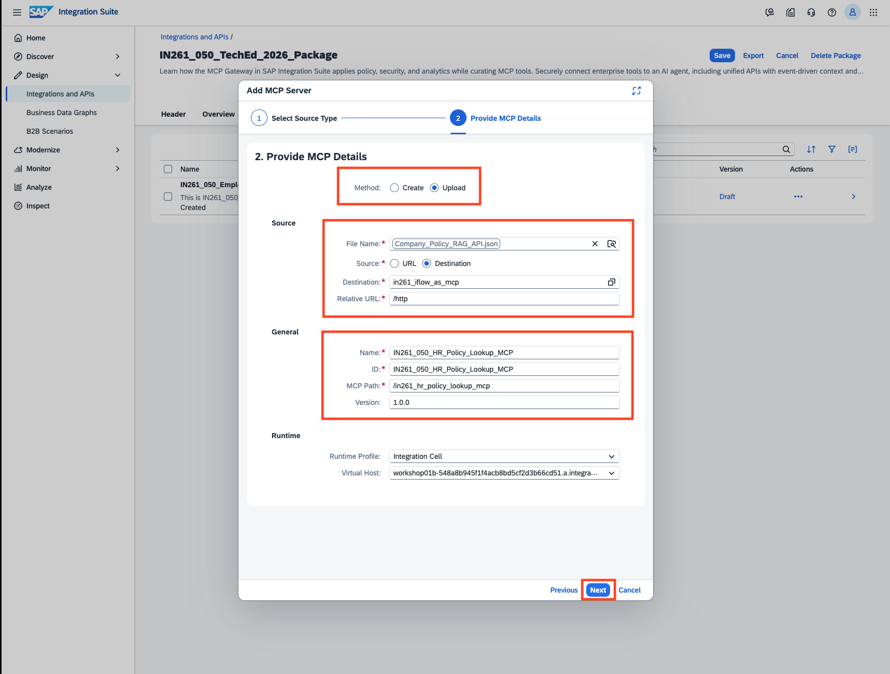

5. On the **Create Tools** screen, select the **/newhire/applicable-hr-policy** tool and click **Add** to finish creating the MCP Server artifact.

   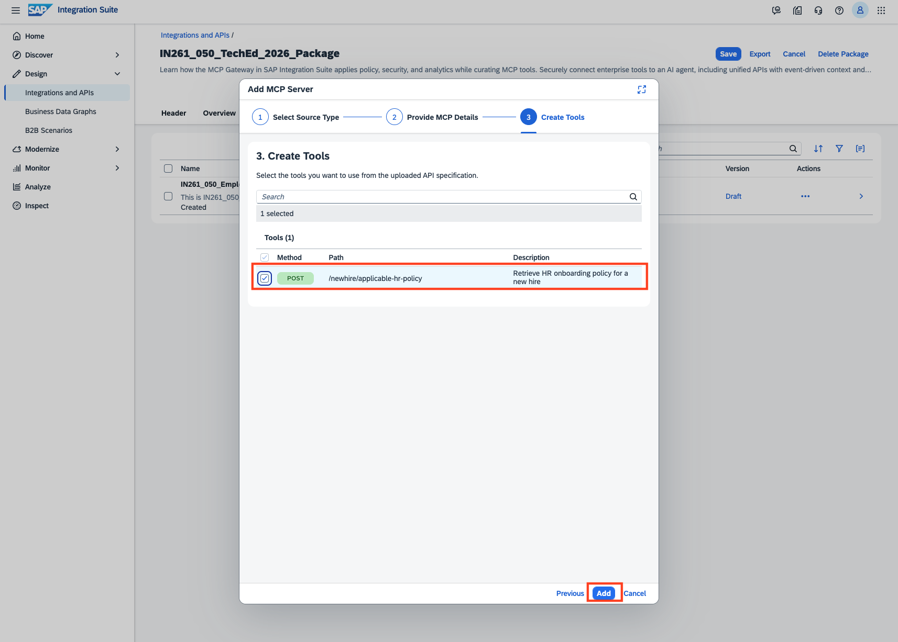

## Exercise 3.3 — Configure the MCP Server

The policy model for the HR Policy MCP Server follows the same authentication configuration as Exercise 2 — External OAuth (OIDC) via IAS, ensuring every agent request is verified before reaching the HR policy backend.

1. Navigate to **MCP Configuration** tab, click **Edit** (top right).

   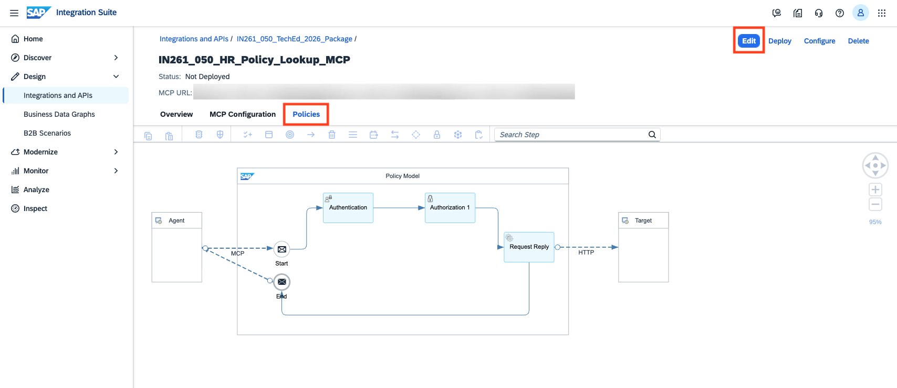

2. Click on the **Policies** tab, then double click on the **Authentication** step to open its property sheet.

3. In the bottom panel, go to the **Policy Settings** tab and configure the following:

   - Check **External OAuth (OIDC)**
   - Set **Configuration Type** to `Well-Known URL`

      Then copy and paste each value below into the corresponding field:
   
      **Well-Known URL:**
      ```
      https://attkvky2u.accounts.ondemand.com/.well-known/openid-configuration
      ```
      **Audience:**
      <br>Leave it empty.
      
      **ClientID Key:**
      ```
      ${authn.oidc.jwt.azp}
      ```
   
      **UserInfo Key:**
      ```
      ${authn.oidc.jwt.email}
      ```

   > **HINT:** Audience is intentionally left empty — IAS tokens in this setup do not carry a fixed audience claim.

4. Click **Save** (top right).

   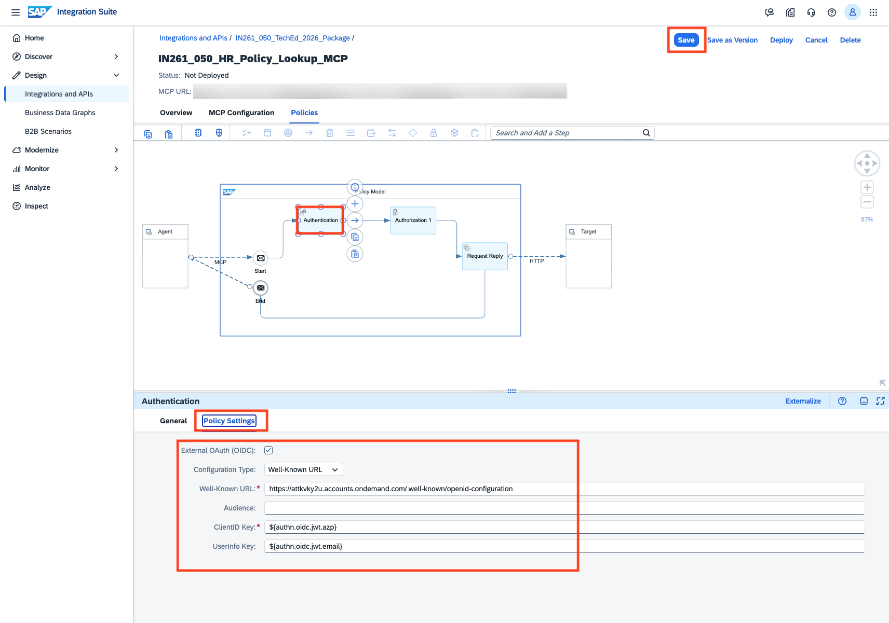

## Exercise 3.4 — Deploy the MCP Server

1. Click **Deploy** (top right). In the confirmation dialog, verify the defaults and click **Deploy** to confirm:

   - **Runtime Profile:** `Integration Cell`
   - **Virtual Host:** *(pre-selected, leave as default)*

   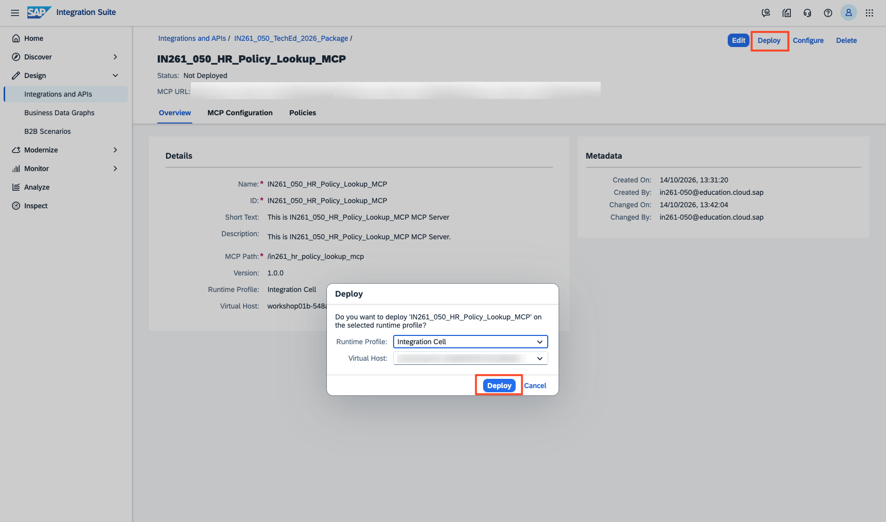

2. Once deployed, the status bar at the top of the artifact page updates to confirm:

   **`Deployed on [date], Runtime Status: STARTED`**

   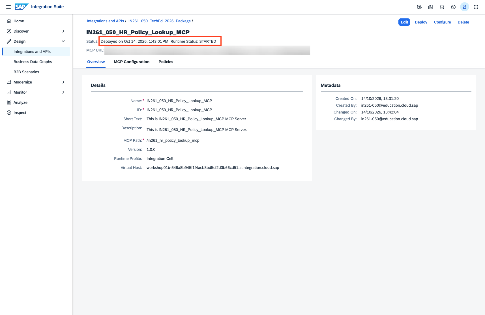

> [!IMPORTANT]
> Make sure the status shows **STARTED** before proceeding to next exercise. If it still shows *Not Deployed*, wait a moment and refresh the page

---

## Summary

At the end of this exercise, you have created and deployed an MCP Server for HR Policy Lookup on the Integration Cell. Together with the Employee Lookup MCP from Exercise 2, the onboarding agent now has governed access to both new hire profile data and relevant HR policies for equipment, system access and training enrollment.

Continue to - [Exercise 4 —  Create, Configure and Deploy an MCP Server for Purchase Requisition Creation in SAP S/4HANA](../ex4/README.md)
