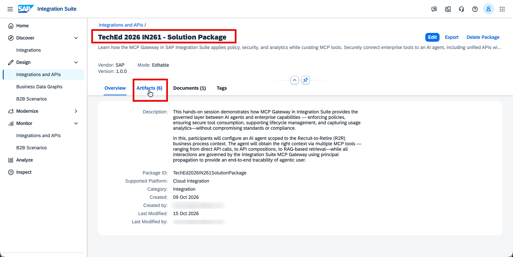
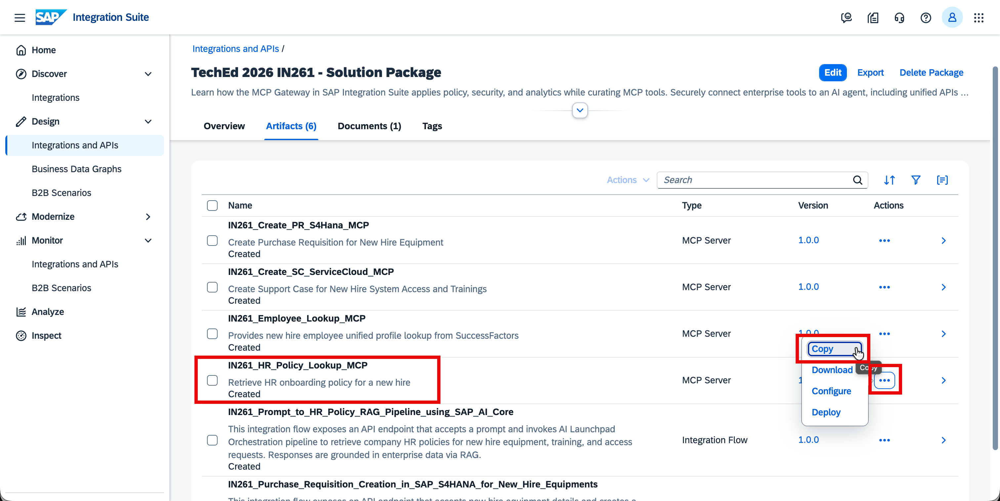
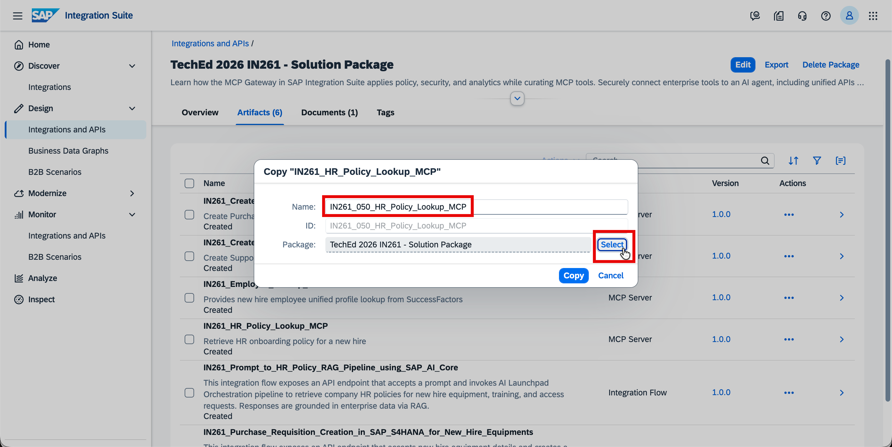
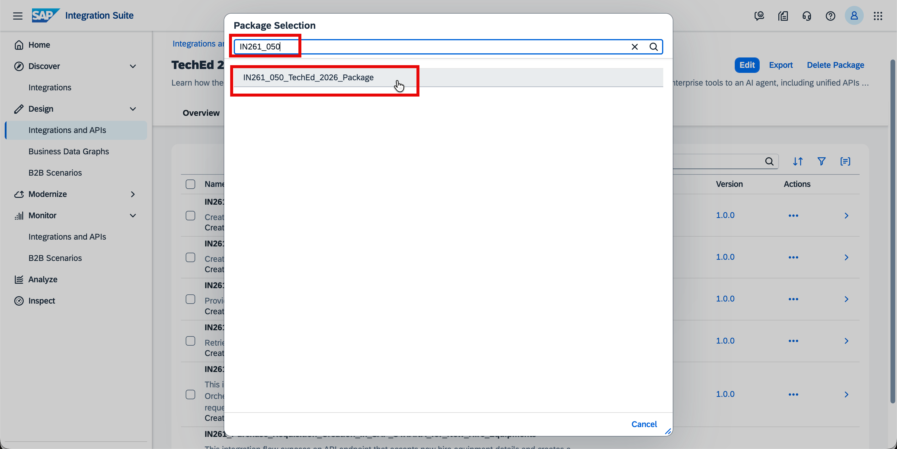
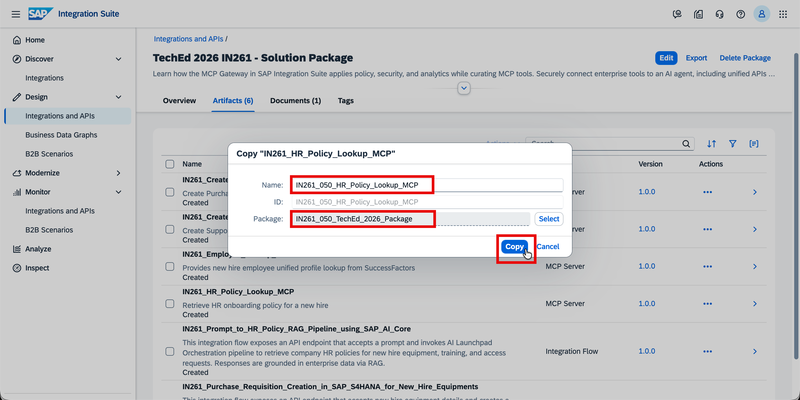
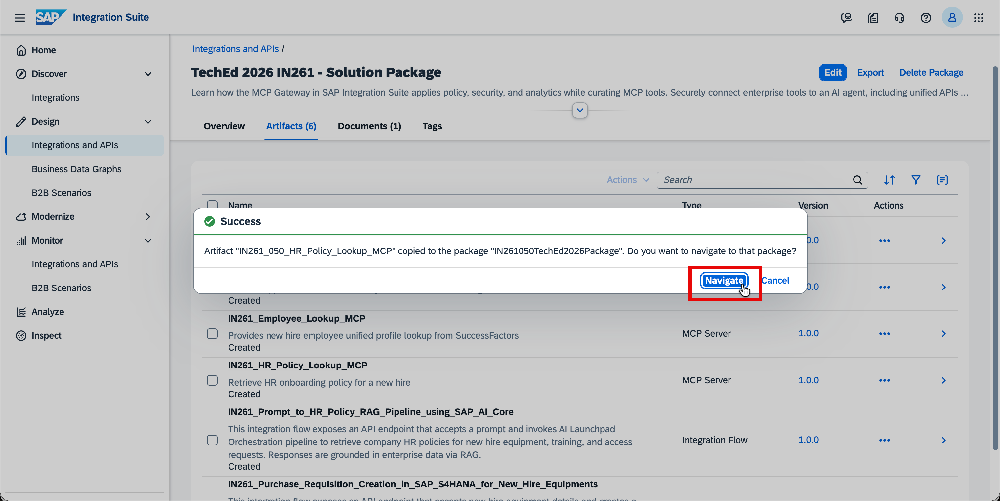
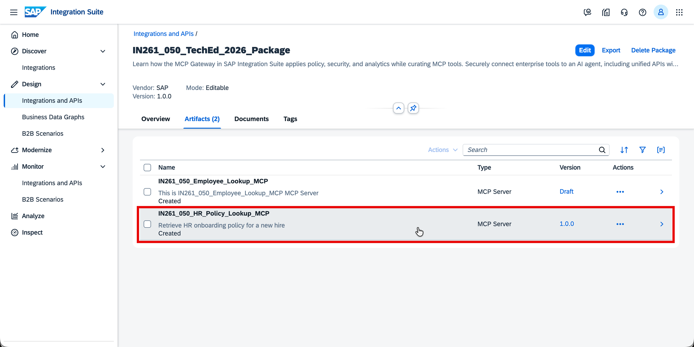
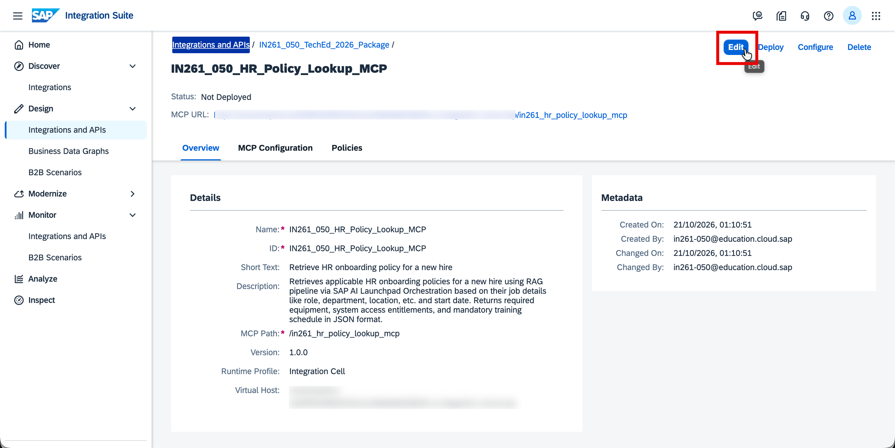
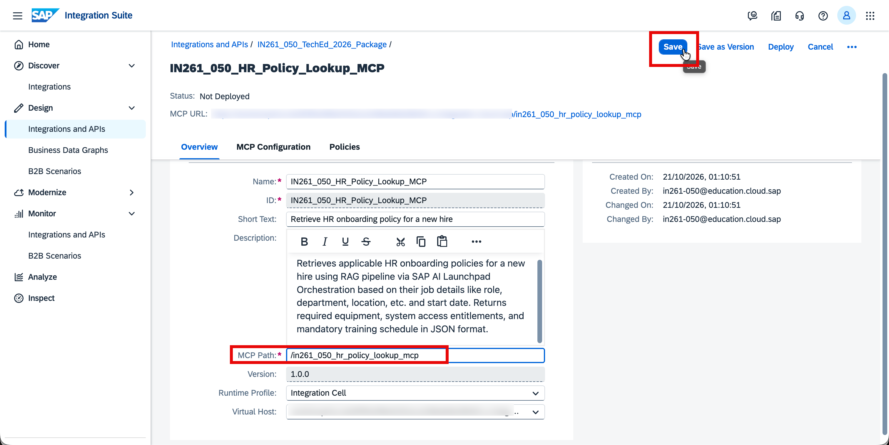
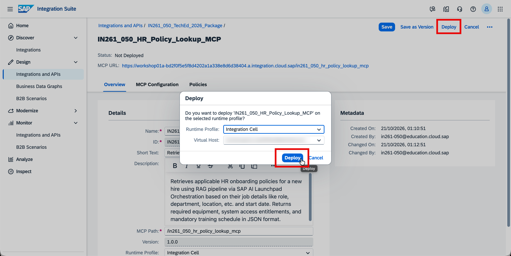

# Exercise 3 — Copy, Configure and Deploy an MCP Server for HR Policy Lookup using SAP AI Launchpad Orchestration with Document Grounding
In this exercise, you will copy a pre-built MCP Server artifact for HR Policy Lookup from the solution package into your existing Integration Package, update the MCP path with your participant number, and deploy it to the Integration Cell.

⏱ **Estimated time: 5 minutes**

## Overview
When a new hire joins, the agent needs to determine what equipment, system access and training enrollment applies — based on their role and location. This information lives in HR policy documents that cannot be queried directly by an AI agent.

**SAP AI Launchpad Orchestration with Document Grounding** solves this by indexing HR policy documents into a vector store and exposing a semantic search API — so the agent can retrieve the most relevant policies in real-time. A pre-configured Integration Flow acts as the governed middleware between the MCP Server and the Document Grounding API.

In Exercise 2, you created an MCP Server from scratch — uploading an OpenAPI Specification and configuring the authentication policy step by step. In this exercise, you follow a different pattern: **copying a pre-built MCP Server artifact** from the solution package.

The artifact comes fully configured — OpenAPI spec, destination, and authentication policy are all included. You only need to update the MCP path with your participant number to make it uniquely yours, then deploy.

The MCP Server connects to a pre-configured Integration Flow that retrieves HR policies via SAP AI Launchpad Orchestration with Document Grounding — returning the most relevant policies for the new hire's role and location.

By the end, you will have a deployed MCP Server that gives the onboarding agent governed, real-time access to HR policies — ready to be consumed alongside the Employee Lookup MCP from Exercise 2.

<strong>📖 Pre-Configured: Integration Flow for HR Policy Lookup</strong>

 

A **pre-configured Integration Flow (Prompt to HR Policy RAG Pipeline using SAP AI Core)** has been configured and deployed for this session. It acts as the governed middleware between the MCP Server and the SAP AI Launchpad Orchestration Document Grounding API:

- Receives the policy query from the MCP tool call
- Handles the API structure mapping and forwards the request to the SAP AI Launchpad Orchestration Document Grounding API
- Extracts and structures the relevant HR policy content from the Orchestration API response
- Returns the policy content back to the agent

> **Note:** For a deeper understanding, refer to [SAP AI Launchpad Document Grounding](https://help.sap.com/docs/sap-ai-launchpad)

## Exercise 3.1 — Copy the MCP Server Artifact from the Solution Package
> [!NOTE]
> This exercise builds on the same Integration Package created in [Exercise 2](../ex2/README.md). You will copy the MCP Server artifact from the solution package into your existing package — no need to create a new one.

1. In SAP Integration Suite, navigate to **Design → Integrations and APIs**, search for and open **TechEd 2026 IN261 - Solution Package**.

   

2. Go to the **Artifacts** tab.

   

3. Find **IN261_HR_Policy_Lookup_MCP** and click the **⋯** (three dots) to open the actions menu. Select **Copy**.

   

4. In the **Copy** dialog, update the **Name** field with your participant number:

   <b>IN261_0**_HR_Policy_Lookup_MCP</b> *(replace ** with the participant number assigned to you)*

   > **Note:** Remove the word "Copy" from the name suffix and also add your participant number as shown below.

   Then click **Select** next to the Package field for selecting your package.

   

5. In the package selection dialog, search for your package <b>IN261_0**_TechEd_2026_Package</b> *(replace ** with the participant number assigned to you)* and click on it to select it.

   

6. Verify the name and package are correct, then click **Copy**.

   

7. Once the success dialog appears, click **Navigate** to open your package where the MCP Server artifact has been copied.

   
   
## Exercise 3.2 — Update the MCP Path
Each MCP Server must have a unique MCP path across the tenant — two artifacts with the same path cannot be deployed simultaneously. You need to update the path to include your participant number.

1. In your package, open the copied MCP Server artifact <b>IN261_0**_HR_Policy_Lookup_MCP</b> *(replace ** with the participant number assigned to you)*.

   

2. Click **Edit** (top right) to enter edit mode.

   

3. In the **Overview** tab, update the **MCP Path** field to include your participant number:

   <b>/in261_0**_hr_policy_lookup_mcp</b> *(replace ** with the participant number assigned to you)*

   Click **Save** (top right).

   

## Exercise 3.3 — Deploy the MCP Server

1. Click **Deploy** (top right). In the confirmation dialog, verify the defaults and click **Deploy** to confirm:

   - **Runtime Profile:** `Integration Cell`
   - **Virtual Host:** *(pre-selected, leave as default)*

   

2. Once deployed, the status bar at the top of the artifact page updates to confirm:

   **`Deployed on [date], Runtime Status: STARTED`**

   Verify that the MCP URL shown reflects your updated MCP path — this confirms the path was saved correctly before deployment.
   
   

> [!IMPORTANT]
> Make sure the status shows **STARTED** before proceeding to the next exercise. If you get a deployment error, verify that the MCP path was updated and saved correctly — two participants cannot share the same MCP path on the same tenant.

## Summary

At the end of this exercise, you have copied and deployed an MCP Server for HR Policy Lookup on the Integration Cell. Together with the Employee Lookup MCP from Exercise 2, the onboarding agent now has governed access to both new hire profile data and relevant HR policies for equipment, system access and training enrollment.

Continue to - [Exercise 4 — Create, Configure and Deploy an MCP Server for Purchase Requisition Creation in SAP S/4HANA](../ex4/README.md)
