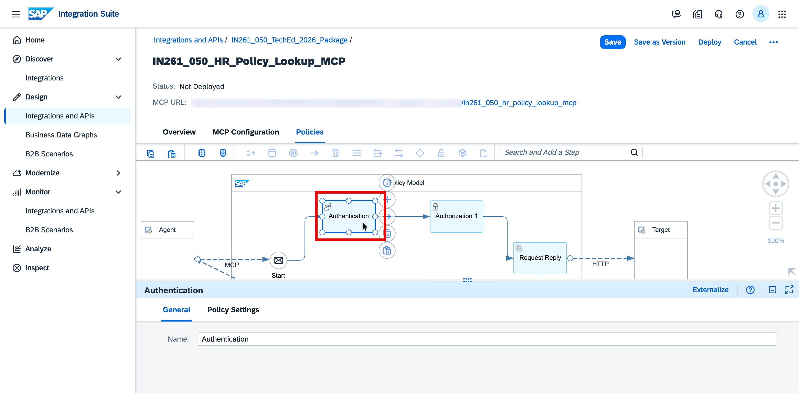

# Exercise 3 — Copy, Configure and Deploy an MCP Server for HR Policy Lookup using SAP AI Launchpad Orchestration with Document Grounding
In this exercise, you will add a second MCP Server to your existing Integration Package — backed by a pre-configured Integration Flow that connects to SAP AI Launchpad Orchestration Document Grounding to retrieve HR policies for equipment, system access and training enrollment relevant to the new hire's role and location.

⏱ **Estimated time: 5 minutes**

## Overview
When a new hire joins, the agent needs to determine what equipment, system access and training enrollment applies — based on their role and location. This information lives in HR policy documents that cannot be queried directly by an AI agent.

**SAP AI Launchpad Orchestration with Document Grounding** solves this by indexing HR policy documents into a vector store and exposing a semantic search API — so the agent can retrieve the most relevant policies in real-time. A pre-configured Integration Flow acts as the governed middleware between the MCP Server and the Document Grounding API.

In this exercise, you will add a second MCP Server to your existing Integration Package: copying a pre-built MCP artifact from the solution package. The artifact comes fully configured — OpenAPI spec, destination, and authentication policy are all included. You only need to update the MCP path with your participant number to make it uniquely yours, then deploy.

The MCP Server connects to a pre-configured Integration Flow that retrieves HR policies via SAP AI Launchpad Orchestration with Document Grounding — returning the most relevant policies for the new hire's role and location.
 
By the end, you will have a deployed MCP Server that gives the onboarding agent governed, real-time access to HR policies — ready to be consumed alongside the Employee Lookup MCP from Exercise 2.

<strong>📖 Pre-Configured: Integration Flow for HR Policy Lookup</strong>

 

A **pre-configured Integration Flow (Prompt to HR Policy RAG Pipeline using SAP AI Core)** has been configured and deployed for this session. It acts as the governed middleware between the MCP Server and the SAP AI Launchpad Orchestration Document Grounding API:

- Receives the policy query from the MCP tool call
- Handles the API structure mapping and forwards the request to the SAP AI Launchpad Orchestration Document Grounding API
- Extracts and structures the relevant HR policy content from the Orchestration API response
- Returns the policy content back to the agent

Instead of building this integration flow from scratch, you will use this pre-configured integration flow as the data source for your MCP Server — it comes with an **OpenAPI Specification** and a **Destination** that you will use when creating the MCP artifact in the next steps.

> **Note:** For a deeper understanding, refer to [SAP AI Launchpad Document Grounding](https://help.sap.com/docs/sap-ai-launchpad)

## Exercise 3.1 — Copy the MCP Server Artifact from the Solution Package

> [!NOTE]
> This exercise builds on the same Integration Package created in [Exercise 2](../ex2/README.md). You will copy the MCP Server artifact from solution package to the existing package — no need to create a new one.

1. In SAP Integration Suite tenant, navigate to **Design → Integrations and APIs**, search for and open solution package **TechEd 2026 IN261 - Solution Package**

   

2. Go to the **Artifacts** tab.

   

3. Lookout for the HR Policy MCP i.e. **IN261_HR_Policy_Lookup_MCP** and click on three dots **...** to open the actions menu

   

4. In the popup, chnage the name specifc to your partcipant number i.e. <b>IN261_0**_HR_Policy_Lookup_MCP</b> *(replace ** with the participant number that is assigned to you)* and for Package click on the the Select button.
   > **Note:** Make sure youpersonlize it by removing the "copy" text from the post fix and puttting your assigned participant number

   

5. In the Package Selection Dialog, serach for your package i.e. <b>IN261_0**_TechEd_2026_PackageM/b> *(replace ** with the participant number that is assigned to you)* and click on it.

   

6. Once you update the name and package, reverify it and finally click on the Copy button

   

7. Once you see the success dialog, click on the Navigae button to open your package where teh MCPs erver artifact got copied.

   
   
## Exercise 3.2 — Update the MCP Path
After copy the MCP server artifact, you need to update the MCP path as you cannopt deploy two MCP server with the same MCP path and thus we need to change to make it unique across the tenant.

1. Open the copied MCP Server artifact i.e. <b>IN261_0**_HR_Policy_Lookup_MCP</b> *(replace ** with the participant number that is assigned to you)*

    

2. Click **Edit** (top right).

   

3. Then double click on the **Authentication** step to open its property sheet.

   

3. In the Overview tab, change the MCP path to make it usinque and as per your assigned [articpnat number

   <b>/in261_0**_employee_lookup_mcp</b> (replace ** with the participant number that is assigned to you)

   Click **Save** (top right).

   

## Exercise 3.3 — Deploy the MCP Server

1. Click **Deploy** (top right). In the confirmation dialog, verify the defaults and click **Deploy** to confirm:

   - **Runtime Profile:** `Integration Cell`
   - **Virtual Host:** *(pre-selected, leave as default)*

   

2. Once deployed, the status bar at the top of the artifact page updates to confirm:

   **`Deployed on [date], Runtime Status: STARTED`**

   Also the MCP URL shoudl show you the updated MCP Path and without this your deployment will fail.
   

> [!IMPORTANT]
> Make sure the status shows **STARTED** before proceeding to next exercise. If you get the deployment error, make sure you update the MCP path as per the suggested syntax

## Summary

At the end of this exercise, you have created and deployed an MCP Server for HR Policy Lookup on the Integration Cell. Together with the Employee Lookup MCP from Exercise 2, the onboarding agent now has governed access to both new hire profile data and relevant HR policies for equipment, system access and training enrollment.

Continue to - [Exercise 4 — Create, Configure and Deploy an MCP Server for Purchase Requisition Creation in SAP S/4HANA](../ex4/README.md)
