# Exercise 4 — Create, Configure and Deploy an MCP Server for Purchase Requisition Creation in SAP S/4HANA
In this exercise, you will add a third MCP Server to your existing Integration Package — backed by a pre-configured Integration Flow that connects to SAP S/4HANA to create Purchase Requisitions for the new hire's approved equipment, after manager approval.

⏱ **Estimated time: 10 minutes**

## Overview
When the manager approves the onboarding plan, the agent needs to create a Purchase Requisition in SAP S/4HANA for the new hire's equipment. This cannot be done directly by the agent — it requires a governed call to the S/4HANA backend.

A pre-configured Integration Flow acts as the mediation layer between the MCP Server and SAP S/4HANA — handling data mapping, the API call to S/4HANA, and returning the Purchase Requisition number back to the agent.

In this exercise, you will add a third MCP Server to your existing Integration Package, configure it with the iFlow's OpenAPI specification and authentication policy, and deploy it to the Integration Cell.

By the end, you will have a deployed MCP Server that gives the onboarding agent governed access to create Purchase Requisitions in SAP S/4HANA — ready to be consumed after manager approval in Exercise 7.

<details>
<summary><strong>📖 Pre-Configured: Integration Flow for Purchase Requisition Creation in SAP S/4HANA</strong></summary>

<br>

A **pre-configured Integration Flow (IN261_Purchase_Requisition_Creation_in_SAP_S4HANA_for_New_Hire_Equipments)** has been configured for this session. It acts as the mediation layer between the MCP Server and SAP S/4HANA:

- Receives the approved equipment payload from the MCP tool call
- Handles data mapping and forwards the request to SAP S/4HANA
- Authenticates to S/4HANA
- Returns the Purchase Requisition number back to the agent

Instead of building this integration flow from scratch, you will use this pre-configured integration flow as the data source for your MCP Server — it comes with an **OpenAPI Specification** and a **Destination** that you will use when creating the MCP artifact in the next steps.

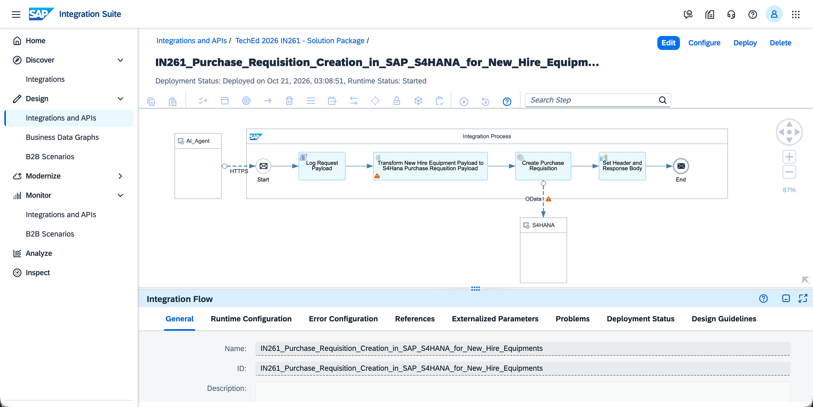

</details>

## Exercise 4.1 — Open your Existing Integration Package

> [!NOTE]
> This exercise builds on the same Integration Package created in [Exercise 2](../ex2/README.md). You will add a new MCP Server artifact to the existing package — no need to create a new one.

1. In SAP Integration Suite tenant, navigate to **Design → Integrations and APIs**, search for and open your package <b>IN261_0**_TechEd_2026_Package</b> *(replace ** with the participant number assigned to you)*.

   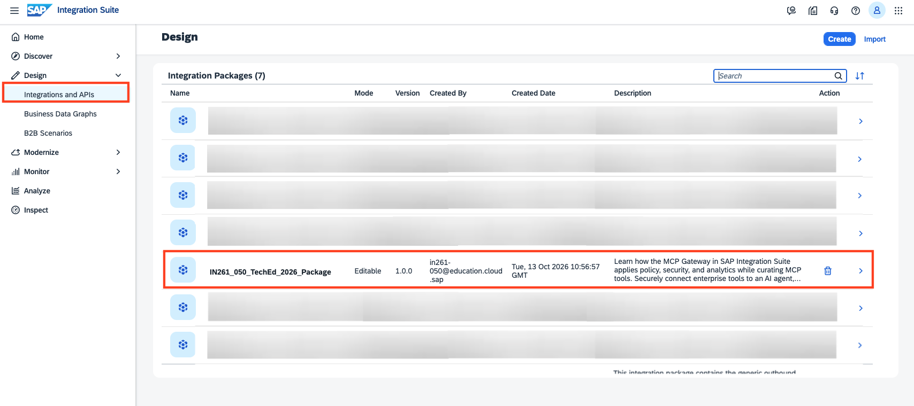

2. Go to the **Artifacts** tab and click **Edit** (top right) to enter edit mode.
   <br>The <b>IN261_0**_Employee_Lookup_MCP artifact</b> from Exercise 2 and <b>IN261_0**_HR_Policy_Lookup_MCP</b> artifact from Exercise 3 will already be visible — you will add the Purchase Requisition MCP Server alongside it.

   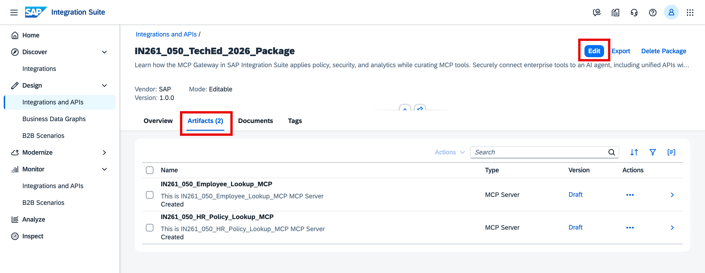

## Exercise 4.2 — Create the MCP Server Artifact

1. Click **Add** and select **MCP Server** from the dropdown.

   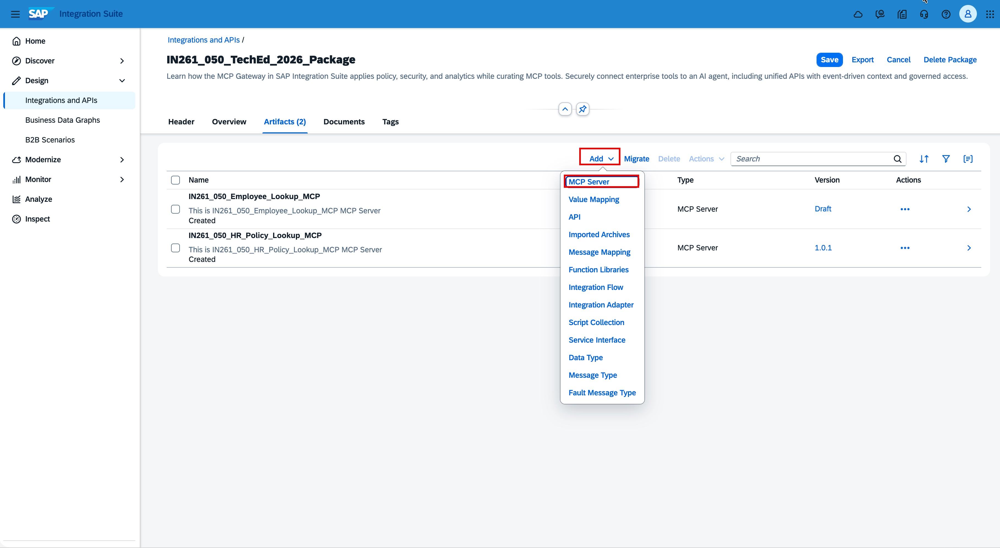

2. In the **Add MCP Server** dialog, select **HTTP Endpoint with OpenAPI Specification** as the source type and click **Next**.

   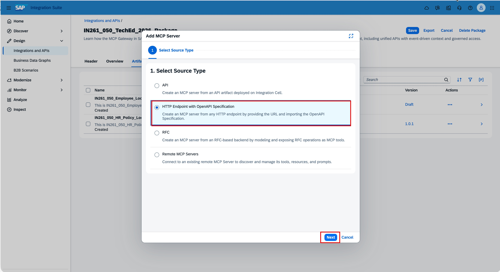

3. Download the OpenAPI Specification: [`OAS_CREATE_PR_API_POST.json`](https://github.com/SAP-samples/teched2026-IN261/releases/download/exercise-assets/OAS_CREATE_PR_API_POST.json) — you will upload it in the next step.

4. Fill in the MCP Server details:

   | Field | Value |
   |---|---|
   | Method | `Upload` |
   | File Name | Upload the `OAS_CREATE_PR_API_POST.json` downloaded in the previous step |
   | Source | `Destination` |
   | Destination | Select `in261_iflow_as_mcp` from the destination list |
   | Relative URL | `/http` |
   | Name | <b>IN261_0**_Create_PR_S4Hana_MCP</b> *(replace ** with the participant number that is assigned to you)* |
   | ID | Auto populated |
   | MCP Path | <b>/in261_0**_create_pr_s4hana_mcp</b> *(replace ** with the participant number that is assigned to you)* |
   | Version | `1.0.0` |

   > **HINT:** The Destination and Relative URL are pre-configured for the workshop — copy exactly as shown, do not modify.

   Click Next.
   
   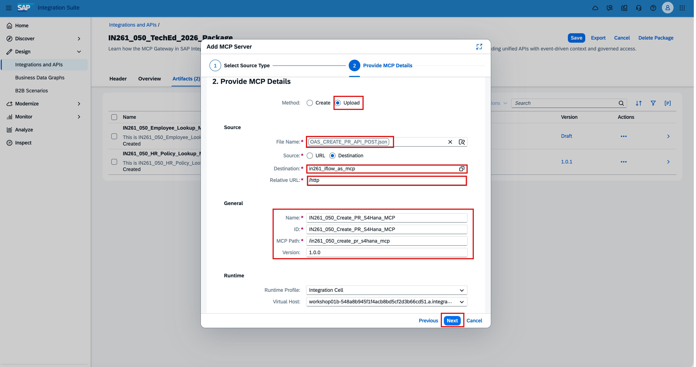

5. On the **Create Tools** screen, select the **/newhire/equipments** tool and click **Add** to finish creating the MCP Server artifact.

   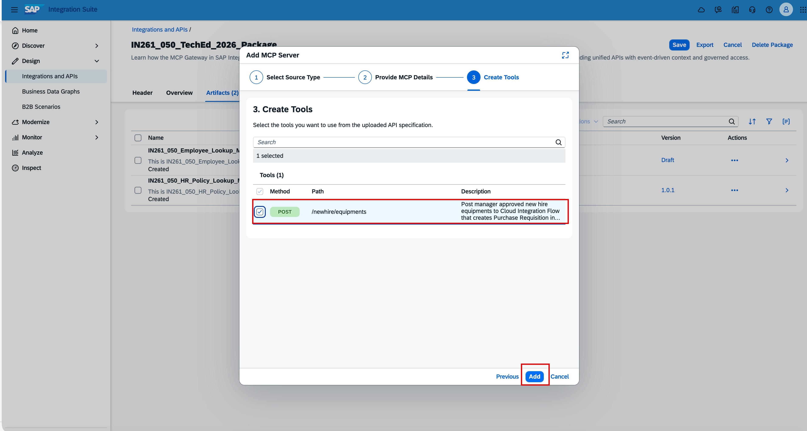

## Exercise 4.3 — Configure the MCP Server

The policy model for the Purchase Requisition MCP Server follows the same authentication configuration as Exercise 2 and 3 — External OAuth (OIDC) via IAS, ensuring every agent request is authenticated and authorized before reaching the S/4HANA backend.

1. Navigate to **Policies** tab, click **Edit** (top right).

   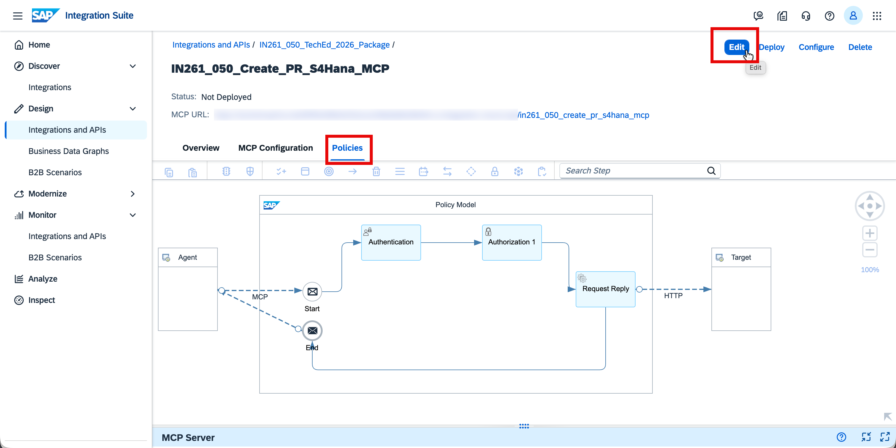
   
2. Then double click on the **Authentication** step to open its property sheet.
   
   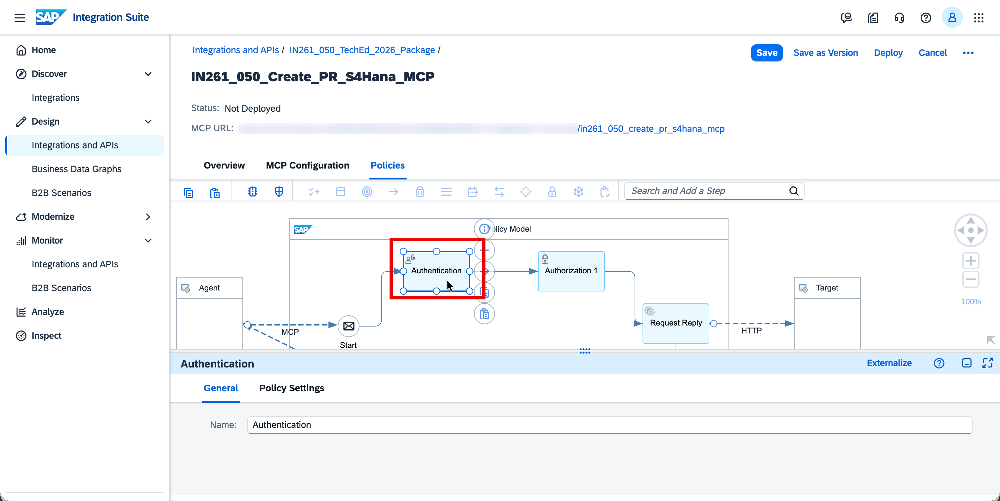

3. In the bottom panel, go to the **Policy Settings** tab and configure the following:

   - Check **External OAuth (OIDC)**
   - Set **Configuration Type** to `Well-Known URL`

      Then copy and paste each value below into the corresponding field:

      **Well-Known URL:**
      ```
      https://attkvky2u.accounts.ondemand.com/.well-known/openid-configuration
      ```
      **Audience:**
      <br>Leave it empty.
      
      **ClientID Key:**
      ```
      ${authn.oidc.jwt.azp}
      ```
   
      **UserInfo Key:**
      ```
      ${authn.oidc.jwt.email}
      ```

   > **HINT:** Audience is intentionally left empty — IAS tokens in this setup do not carry a fixed audience claim.

   Click **Save** (top right).

   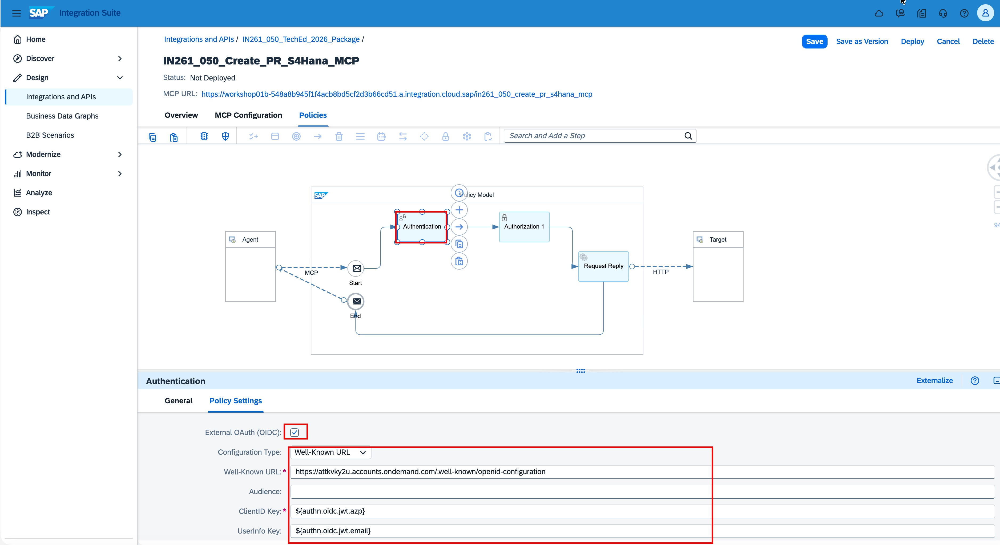

## Exercise 4.4 — Deploy the MCP Server

1. Click **Deploy** (top right). In the confirmation dialog, verify the defaults and click **Deploy** to confirm:

   - **Runtime Profile:** `Integration Cell`
   - **Virtual Host:** *(pre-selected, leave as default)*

   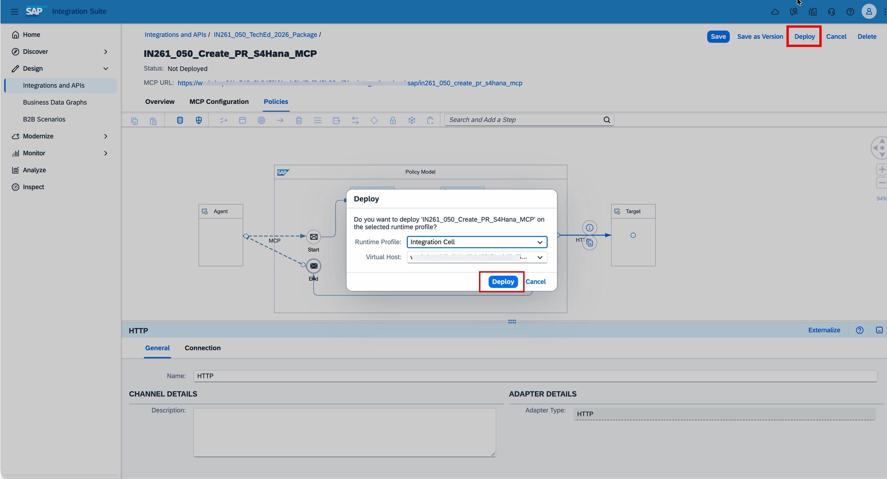
   
2. Once deployed, the status bar at the top of the artifact page updates to confirm:

   **`Deployed on [date], Runtime Status: STARTED`**

   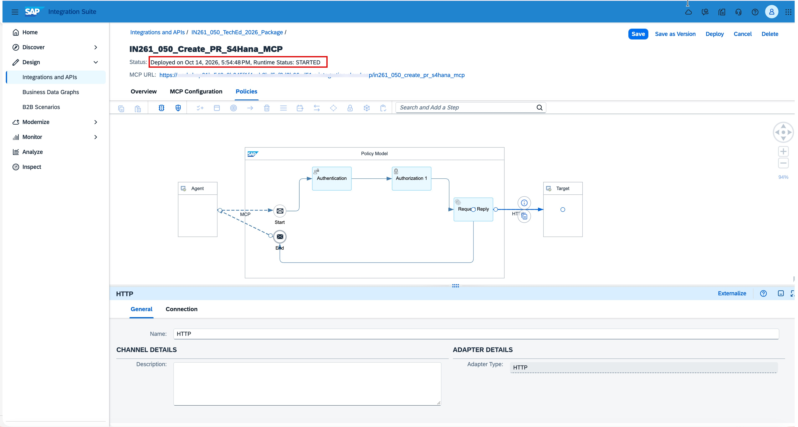

> [!IMPORTANT]
> Make sure the status shows **STARTED** before proceeding to next exercise. If it still shows *Not Deployed*, wait a moment and refresh the page.

## Summary

At the end of this exercise, you have created and deployed an MCP Server for Purchase Requisition Creation on the Integration Cell. Together with the Employee Lookup and HR Policy MCPs from Exercises 2 and 3, the onboarding agent now has governed access to new hire profile data, relevant HR policies, and the ability to create Purchase Requisitions in SAP S/4HANA system.

Continue to - [Exercise 5 — Copy, Configure and Deploy an MCP Server for Support Case Creation in SAP Service Cloud V2](../ex5/README.md)
