# Exercise 5 — Copy, Configure and Deploy an MCP Server for Support Case Creation in SAP Service Cloud V2
In this exercise, you will copy a pre-built MCP Server artifact from the solution package into your existing Integration Package, update the MCP path with your participant number, and deploy it to the Integration Cell.

⏱ **Estimated time: 5 minutes**

## Overview
When the manager approves the onboarding plan, the agent needs to create a Support Case in SAP Service Cloud V2 for the new hire's IT system access and training enrollment. This cannot be done directly by the agent — it requires a governed call to the Service Cloud backend.

Unlike the HR Policy and Purchase Requisition MCPs which go through an Integration Flow, this MCP Server connects directly to the SAP Service Cloud V2 API — the MCP Gateway sits in front of the API, enforcing authentication and authorization before any request reaches the backend.

In Exercise 4, you created an MCP Server from scratch — uploading an OpenAPI Specification and configuring the authentication policy step by step. In this exercise, you follow the same pattern as Exercise 3: **copying a pre-built artifact** from the solution package.

The artifact comes fully configured — OpenAPI spec and authentication policy are all included. You only need to update the MCP path with your participant number to make it uniquely yours, then deploy.

This MCP Server connects **directly to the SAP Service Cloud V2 API**. It exposes two tools: one to look up the employee's internal UUID in Service Cloud, and one to create a Support Case for IT system access and training enrollment after manager approval.

By the end, you will have a deployed MCP Server for Support Case Creation in your package — ready to be consumed by the AI agent in Exercise 7.

<strong>📖 For the Curious: Inside the Service Cloud MCP Server</strong>

 

The MCP Server was created from the SAP Service Cloud V2 OpenAPI Specification — exposing two tools directly from the Service Cloud REST API with no middleware in between:

| Tool | Method | Path | Description |
|---|---|---|---|
| `get_sap_c4c_api_v1_employee_service_employees` | `GET` | `/sap/c4c/api/v1/employee-service/employees` | Looks up a Service Cloud employee using `$filter=displayId eq '{id}'` to retrieve their internal UUID |
| `post_sap_c4c_api_v1_case_service_cases` | `POST` | `/sap/c4c/api/v1/case-service/cases` | Creates a Support Case with subject, employee, reporter, system access details, and training details |

**Authentication:** Technical user via Client Credentials Grant Type — unlike Exercise 2, Principal Propagation is not used here. The MCP Gateway authenticates the agent call via IAS OAuth, then the backend call uses a pre-configured technical user credential.

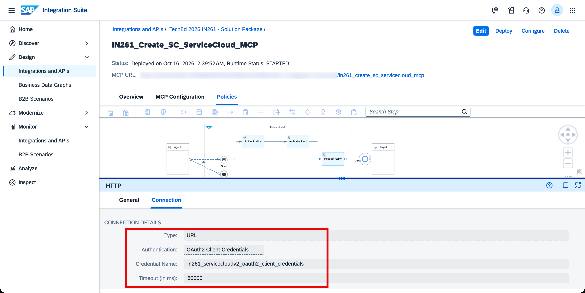

## Exercise 5.1 — Copy the MCP Server Artifact from the Solution Package
> [!NOTE]
> This exercise builds on the same Integration Package created in [Exercise 2](../ex2/README.md). You will copy the MCP Server artifact from the solution package into your existing package — no need to create a new one.

1. In SAP Integration Suite, navigate to **Design → Integrations and APIs**, search for and open **TechEd 2026 IN261 - Solution Package**.

   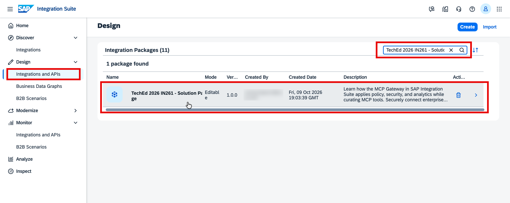

2. Go to the **Artifacts** tab.

   

3. Find **IN261_Create_SupportCase_MCP** and click the **⋯** (three dots) to open the actions menu. Select **Copy**.

   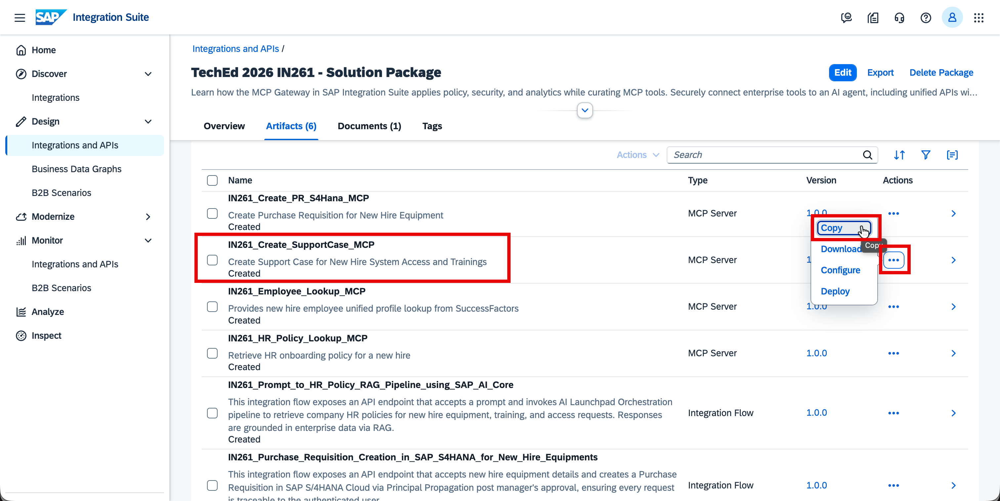

4. In the **Copy** dialog, update the **Name** field with your participant number:

   <b>IN261_0**_Create_SupportCase_MCP</b> *(replace ** with the participant number assigned to you)*

   > **Note:** Remove the word "Copy" from the name suffix and replace it with your participant number as shown above.

   Then click **Select** next to the Package field.

   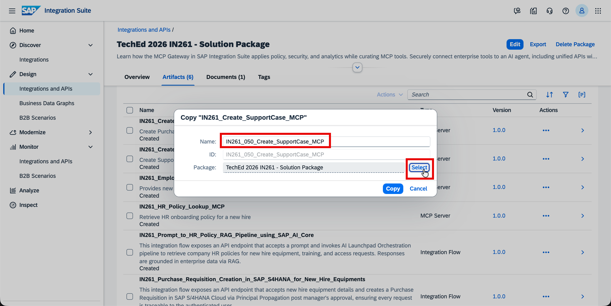

5. In the package selection dialog, search for your package <b>IN261_0**_TechEd_2026_Package</b> *(replace ** with the participant number assigned to you)* and click on it to select it.

   

6. Verify the name and package are correct, then click **Copy**.

   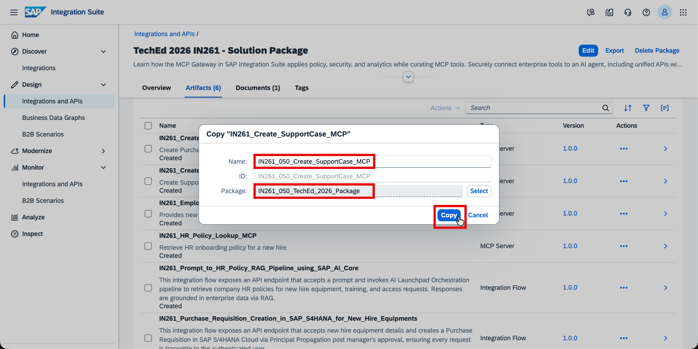

7. Once the success dialog appears, click **Navigate** to open your package where the MCP Server artifact has been copied.

   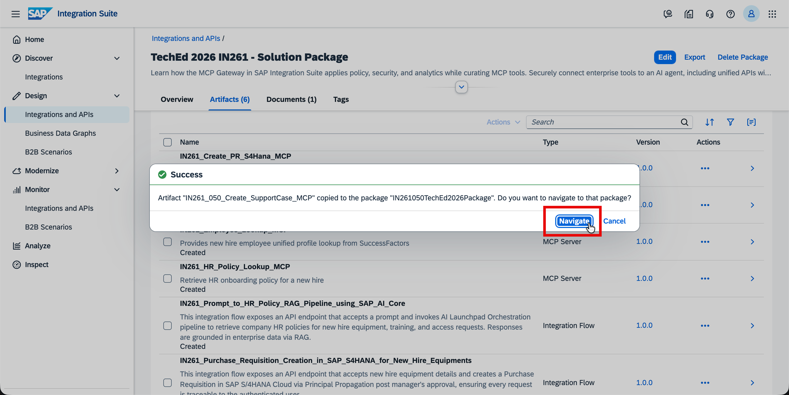

## Exercise 5.2 — Update the MCP Path

Each MCP Server must have a unique MCP path across the tenant — two artifacts with the same path cannot be deployed simultaneously. You need to update the path to include your participant number.

1. In your package, open the copied MCP Server artifact <b>IN261_0**_Create_SupportCase_MCP</b> *(replace ** with the participant number assigned to you)*.

   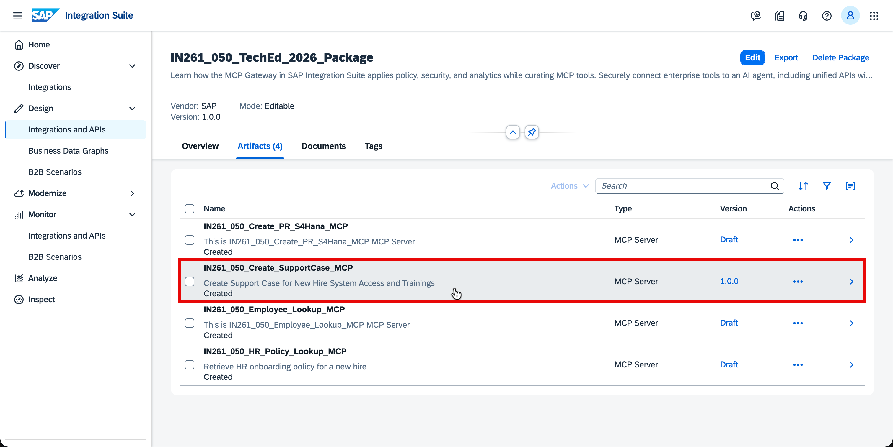

2. Click **Edit** (top right) to enter edit mode.

   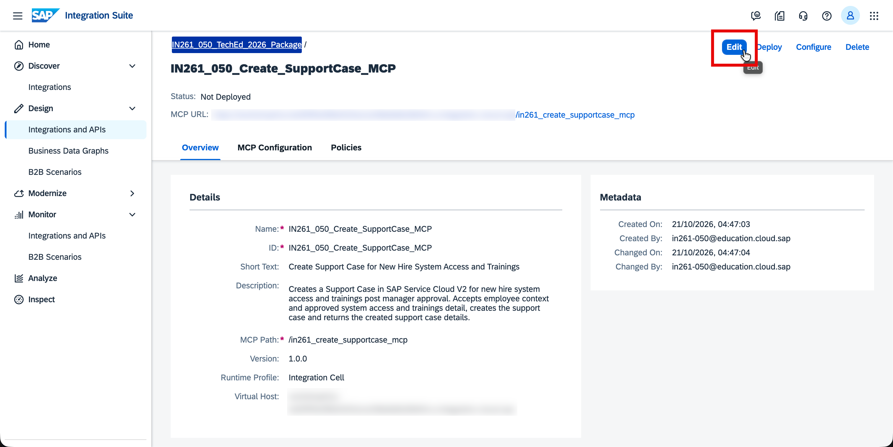

3. In the **Overview** tab, update the **MCP Path** field to include your participant number:

   <b>/in261_0**_create_supportcase_mcp</b> *(replace ** with the participant number assigned to you)*

   Click **Save** (top right).

   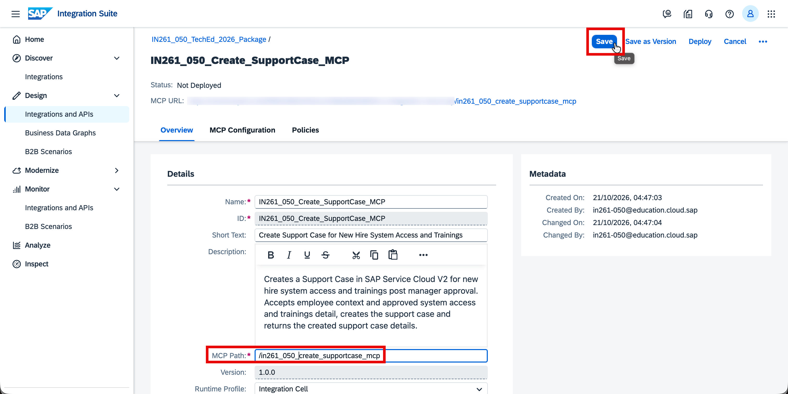

## Exercise 5.3 — Deploy the MCP Server

1. Click **Deploy** (top right). In the confirmation dialog, verify the defaults and click **Deploy** to confirm:

   - **Runtime Profile:** `Integration Cell`
   - **Virtual Host:** *(pre-selected, leave as default)*

   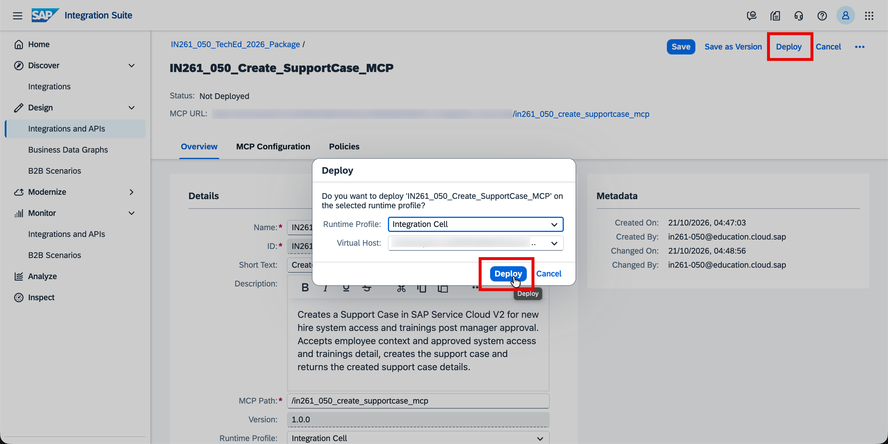

2. Once deployed, the status bar at the top of the artifact page updates to confirm:

   **`Deployed on [date], Runtime Status: STARTED`**

   Verify that the MCP URL shown reflects your updated MCP path — this confirms the path was saved correctly before deployment.

   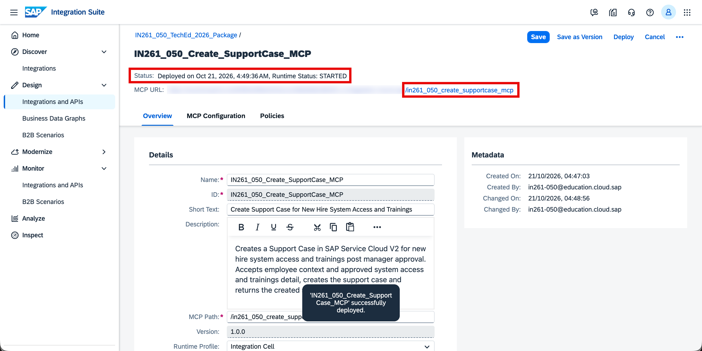

> [!IMPORTANT]
> Make sure the status shows **STARTED** before proceeding to the next exercise. If you get a deployment error, verify that the MCP path was updated and saved correctly — two participants cannot share the same MCP path on the same tenant.

Your Integration Package now contains all four MCP Servers — all in **Started** status. Verify this before moving on:

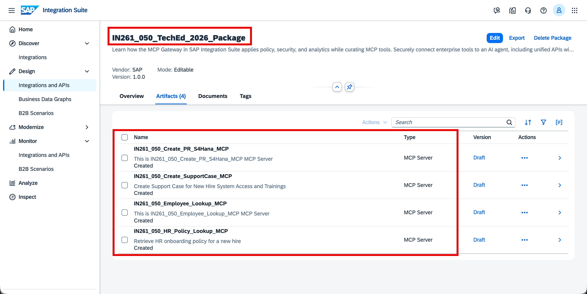

## Summary
At the end of this exercise, you have copied and deployed an MCP Server for Support Case Creation to the Integration Cell. Together with the MCP Servers from Exercises 2, 3, and 4, the onboarding agent now has governed access to the complete new hire profile, HR policies, Purchase Requisition creation, and now Support Case creation in SAP Service Cloud V2.

Continue to - [Exercise 6 - Publish Deployed MCP Servers as a Product and Subscribe to the AI Agent in Developer Hub](../ex6/README.md)
