# Exercise 6 — Publish Deployed MCP Servers as a Product and Subscribe to the AI Agent in Developer Hub
In this exercise, you will publish your four deployed MCP Servers as a product in the Developer Hub and add your product to the existing AI Agent subscription — making your MCP tools available to the Employee Onboarding AI Agent.

⏱ Estimated time: 10 minutes

## Overview
With four MCP Servers deployed across Exercises 2, 3, 4, and 5, the employee onboarding AI agent now has governed access to employee data, HR policies, purchase requisition creation, and support case creation. But deployment alone is not enough — for an AI agent to discover and call these tools, they need to be published as a **Product** in the **Developer Hub** and linked to the **AI Agent subscription**.

The **Developer Hub** is the API and Events catalog built into SAP Integration Suite. It is where APIs, Events and MCP tools are published, discovered, and subscribed to — giving organizations a governed, self-service way to expose enterprise capabilities to consumers, including AI agents.

In this exercise, you will publish all four MCP Servers as a single product, then add your product to the existing **IN261 Employee Onboarding AI Agent** subscription. The subscription was pre-created by the instructor — by adding your product to it, you authorize the agent to authenticate and call your specific MCP tools.

By the end, your four deployed MCP Servers are bundled as a governed product in the Developer Hub and the AI Agent is authorized to call them — ready for Exercise 7.

## Exercise 6.1 — Navigate to Developer Hub
In this exercise, you navigate to the Developer Hub.

1. From your Integration Package <b>IN261_0**_TechEd_2026_Package</b> (replace ** with your participant number), click the **grid icon (⠿)** in the top-right navigation bar.

   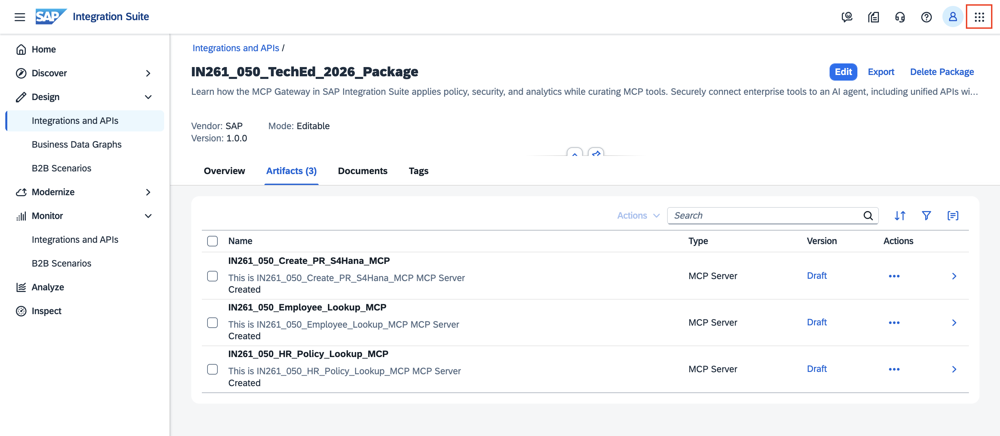
   
2. In the menu that appears, click **Developer Hub**.

   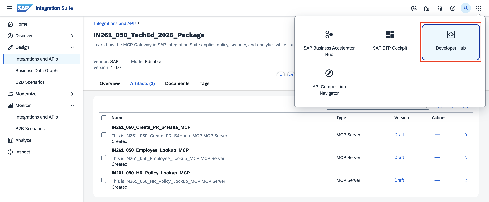

3. You will land on the **Developer Hub** home page.
   Notice that a product **`IN261 Employee Onboarding`** is already visible in the catalog. This is a **solution product** pre-configured by the session instructors — it also contains the  four solution MCP Servers bundled and published as a reference. In the steps below, you will create your own participant-specific product in exactly the same way.

   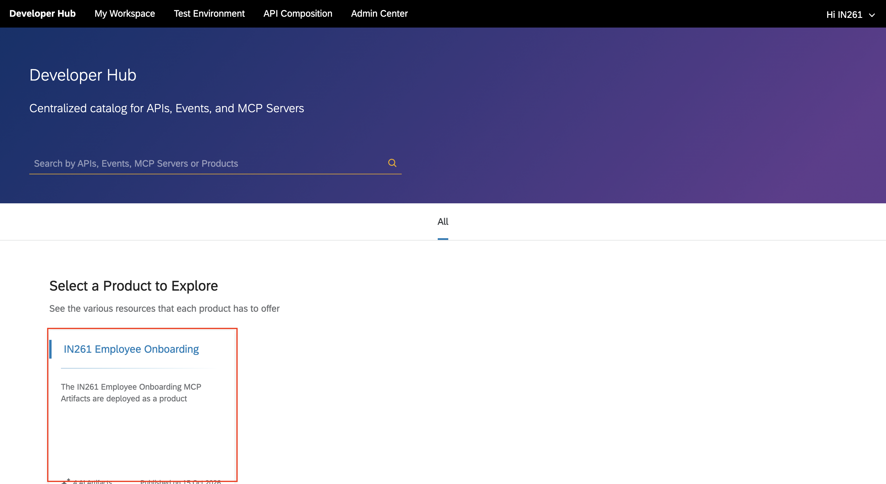

## Exercise 6.2 — Publish your Deployed MCP Servers as a Product
In this exercise, you select all your four deployed MCP Servers, and publish them as a single product.

1. In the Developer Hub top navigation bar, click **Admin Center**.

2. From the dropdown, select **Content**.

   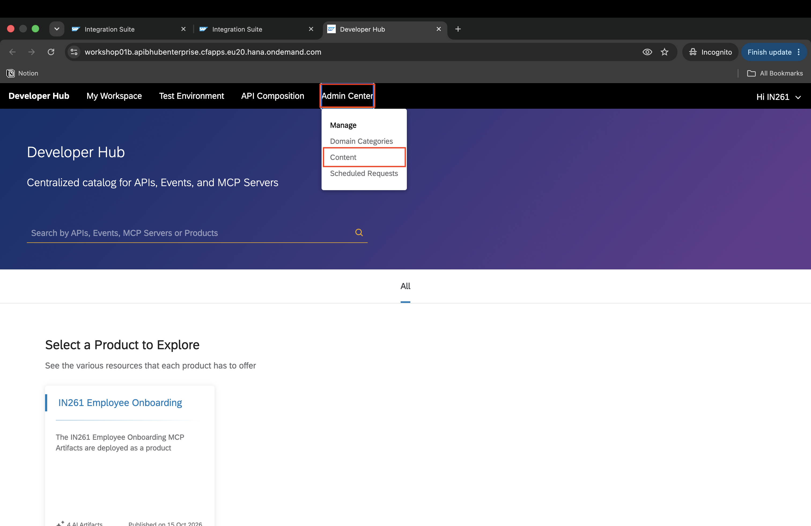

3. On the **Manage Content** page, the **Business Systems** tab is active by default.

4. Click on the business system matching your assigned tenant — **workshop01a** if your participant number is **001–020**, or **workshop01b** if your participant number is **021–040**.

   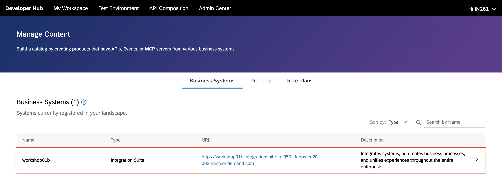

5. Click the **AI Artifacts** tab. You will see all MCP Servers from all the participants deployed on this business system.

6. Use the **Search by Name** field to filter by your participant number i.e. <b>IN261_0**</b> (replace ** with your participant number)(e.g. `IN261_050`). This narrows the list to your four MCP Servers.

7. Select all four by checking the checkbox next to each:
   - <b>IN261_0**_Employee_Lookup_MCP</b> (replace ** with your participant number)
   - <b>IN261_0**_HR_Policy_Lookup_MCP</b> (replace ** with your participant number)
   - <b>IN261_0**_Create_PR_S4Hana_MCP</b> (replace ** with your participant number)
   - <b>IN261_0**_Create_SupportCase_MCP</b> (replace ** with your participant number)

   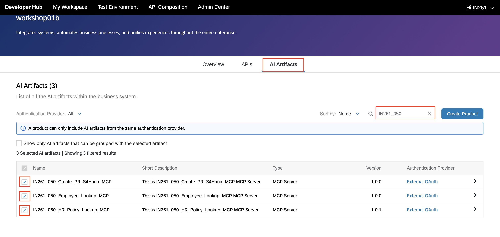

8. Verify you have **4 Selected AI artifacts**, then click **Create Product**.

   

9. Fill in the product details:

| Field | Value |
|---|---|
| Name |  <b>IN261_0** Employee Onboarding</b> (replace ** with your participant number) |
| ID |  <b>IN261_0** Employee Onboarding</b> (replace ** with your participant number)|
| Short Text | `The IN261_0** Employee Onboarding MCP Artifacts are deployed as a product.` (replace ** with your assigned participant number) |
| Description | `The IN261_0** Employee Onboarding MCP Artifacts are deployed as a product.` (replace ** with your assigned participant number)|

Click **Publish**.

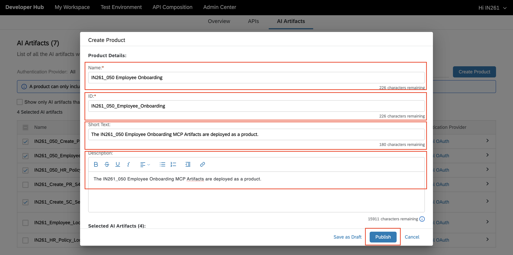

10. An **Information** dialog confirms your publish request has been submitted. Click **Close**.

   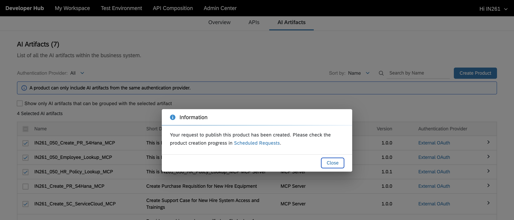

> [!NOTE]
> Publishing triggers an AI-assisted content creation process in the background. You can monitor progress in **Admin Center → Scheduled Requests**.

## Exercise 6.3 — Monitor via Scheduled Requests

1. Click **Admin Center** and select **Scheduled Requests**.

   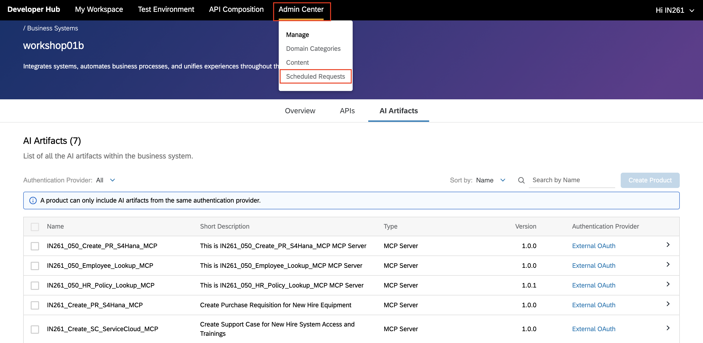

2. You will see your product <b>IN261_0** Employee Onboarding</b> listed with status **In Progress**. Wait until the status changes to **Success** before proceeding.

   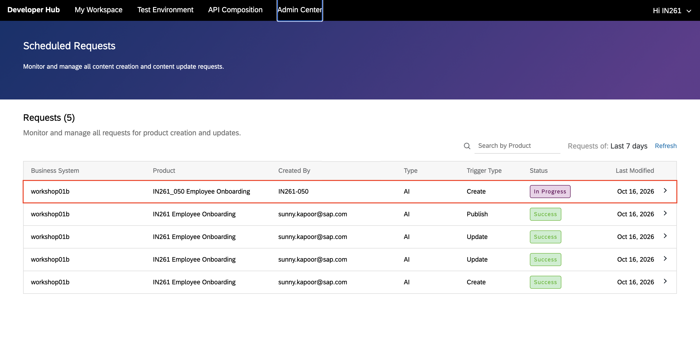

3. Once the Scheduled Request shows **Success**, click **Developer Hub** in the top navigation bar to return to the home page. Your product <b>IN261_0** Employee Onboarding</b> should now appear in the catalog.

   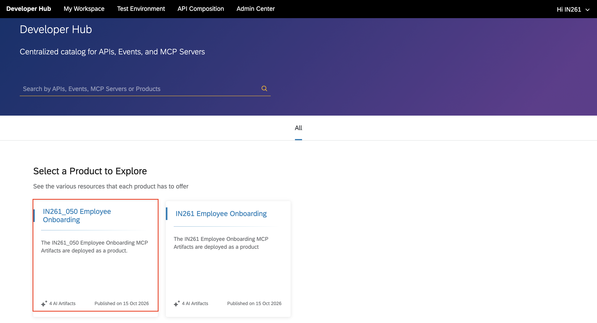

## Exercise 6.4 — Add your Product to the Existing AI Agent Subscription
In this exercise, you add your published product to the existing AI Agent subscription — authorizing the employee onboarding agent to authenticate and call your MCP tools.

1. From the Developer Hub home page, click on <b>IN261_0** Employee Onboarding</b> (replace ** with your participant number) to open it.

   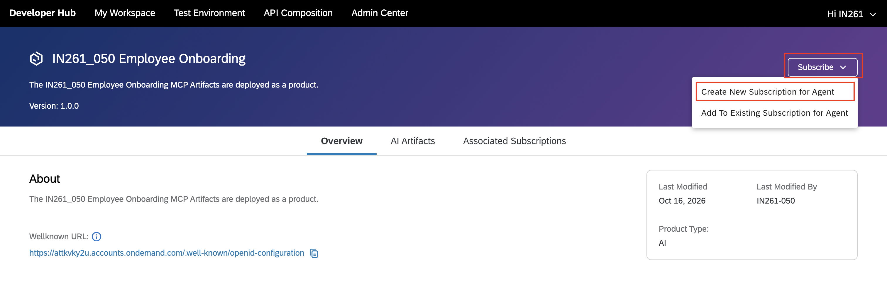

2. On the product detail page, click **Subscribe** (top right) and select **Add To Existing Subscription for Agent** from the dropdown.

   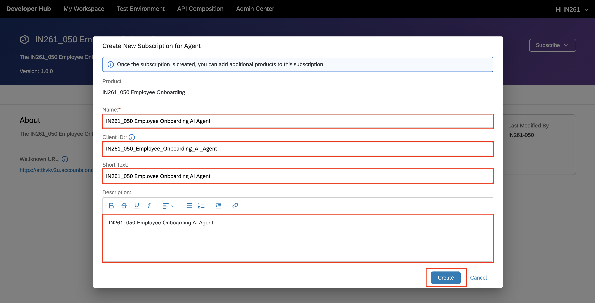
   
3. In the dialog, sfind select **IN261 Employee Onboarding AI Agent**.

   Click Add.

   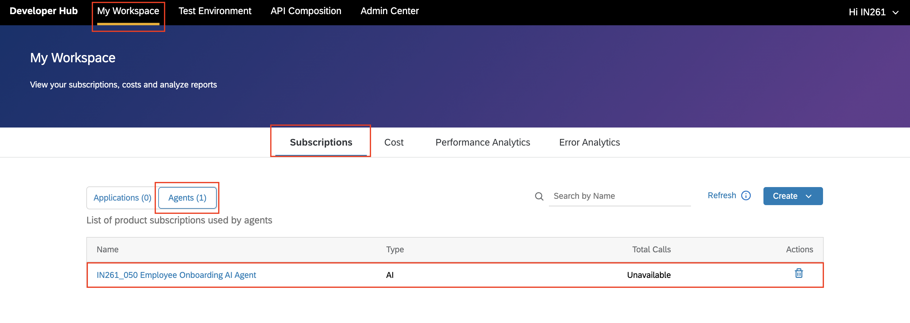

4. A confirmation message appears — your product is now linked to the existing AI Agent subscription.

   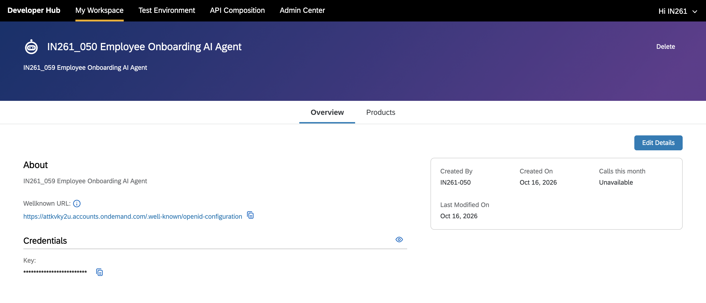

▎ [!NOTE]
▎ Why add to an existing subscription instead of creating a new one?
▎ The AI Agent authenticates to the Developer Hub using a single IAS (Identity Authentication Service) app registration — which means all participants share the same OAuth Client ID. The Developer Hub enforces one Agent subscription per Client ID, so creating a new subscription is not possible. Instead, each participant adds their product to the one shared subscription — the agent's single identity gets access to all participant products this way.

## Summary
You have published your four MCP Servers as a governed product in the Developer Hub and added it to the existing AI Agent subscription.

- All four MCP tools are bundled into a single discoverable product IN261_0** Employee Onboarding in the Developer Hub catalog
- Adding your product to the existing subscription authorizes the agent to authenticate and call your specific MCP tools
- The agent credentials are pre-configured in the agent bundle — in Exercise 7, you only need to provide your MCP Server URLs

Continue to - [Exercise 7 — Download, Configure, and Run the Employee Onboarding AI Agent](../ex7/README.md)
