# Exercise 7 — Download, Configure, and Run the Employee Onboarding AI Agent
In this exercise, you will download the pre-built Employee Onboarding AI Agent from the Solution Package, configure it with your deployed MCP Server URLs, and run it — so it is ready to receive new hire events from SAP Advanced Event Mesh and orchestrate the full onboarding workflow.

⏱ **Estimated time: 15 minutes**

## Overview
The Employee Onboarding AI Agent is a pre-built **Node.js agent** powered by **Claude via SAP AI Core**. It listens for **new hire events** from **SAP SuccessFactors via Advanced Event Mesh** and orchestrates the full onboarding process — **fetching employee data**, **retrieving HR policies**, presenting an **onboarding plan for manager approval**, and after approval **creating a Purchase Requisition** for approved equipments **in SAP S/4HANA** and a **Support Case** for approved system access and training enrollment **in SAP Service Cloud V2**.

All tool calls are routed through the **SAP Integration Suite MCP Gateway** using the **four MCP Servers you deployed and published** in Exercises 2 through 6 — authenticated, authorized, and traceable end to end.

By the end, your agent is running, connected to your AEM queue, and waiting for a new hire event — ready for Exercise 8.

## Exercise 7.1 — Download the Agent Bundle
In this exercise, you download the pre-built agent bundle from the **TechEd 2026 IN261 - Solution Package** in SAP Integration Suite.

1. In SAP Integration Suite, navigate to **Design → Integrations and APIs**.

   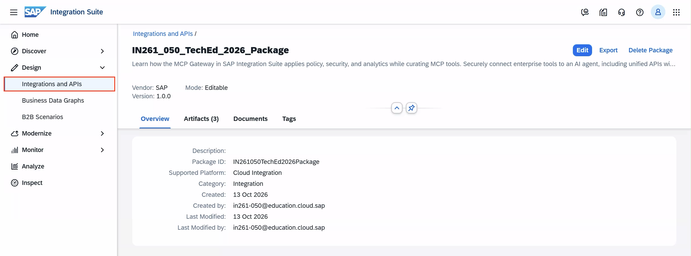

2. In the search field, type **`TechEd 2026 IN261 - Sol`** and press Enter. Click on **`TechEd 2026 IN261 - Solution Package`** to open it.

   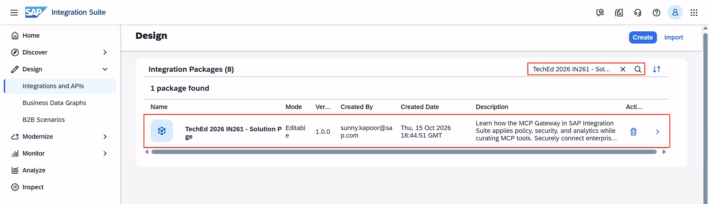

3. Inside the Solution Package, click the **Documents (1)** tab and then click on **`IN261 Best Run Employee Onboarding AI Agent`** to download it.
   <br>The file **`IN261_employee_onboarding_ai_agent.zip`** will begin downloading — you will see it appear in your browser's download bar.

   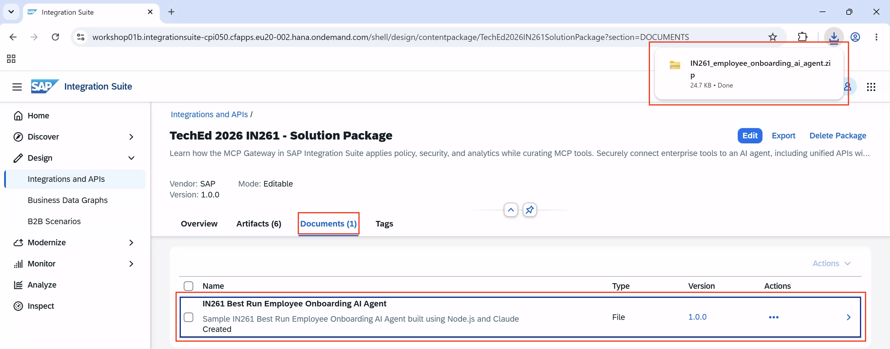

4. Open your **Downloads** folder. You will find **`IN261_employee_onboarding_ai_agent.zip`** there.

   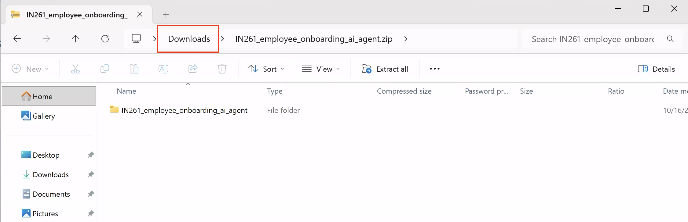

5. Right-click the zip file and select **Extract All...**.

   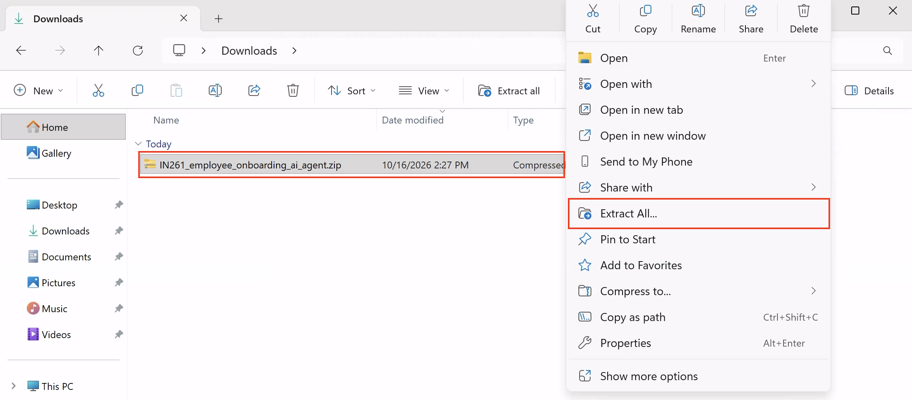

6. In the **Extract Compressed (Zipped) Folders** dialog, keep the default destination path and click **Extract**.

   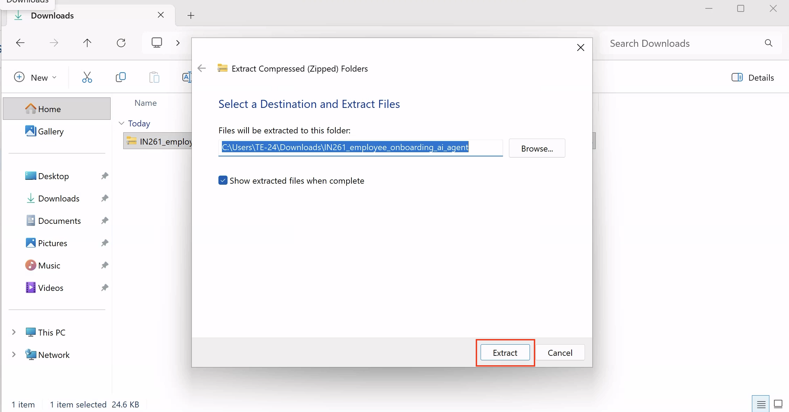

7. The extracted folder **`IN261_employee_onboarding_ai_agent`** now appears in your **Downloads** folder alongside the zip.

   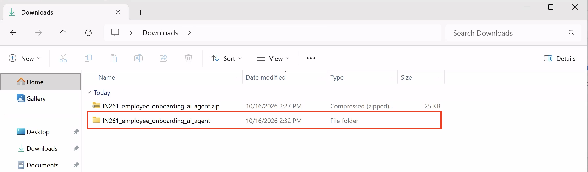

## Exercise 7.2 — Configure Your MCP Server URLs
The agent bundle folder includes a file called **`mcp-servers.json`**. The **`active`** section of this file contains entries for all four MCP Servers — but their **`url`** fields are empty. You need to fill in the MCP Server URLs from your published product in the Developer Hub.

> [!TIP]
> **Fast Track:** If you have not yet deployed your own MCP Servers or ran into some issues, the same **`mcp-servers.json`** file already contains the instructor-deployed solution URLs under **`workshop_01a_solution`** or **`workshop_01b_solution`**. Copy the URL values from the section that matches your assigned tenant and paste them into the corresponding **`url`** fields in the **`active`** section, then proceed to Exercise 7.3.

1. Open the extracted folder **`IN261_employee_onboarding_ai_agent`**.
   
2. Open **`mcp-servers.json`** in VS Code or any text editor.

   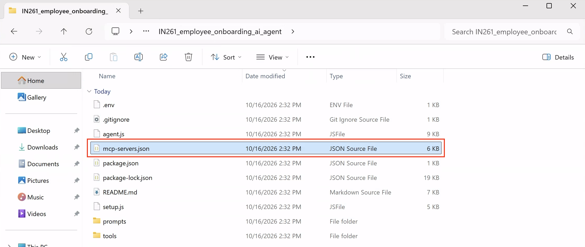

3. In the **`active`** section you will see four MCP Server entries. All four **`url`** fields are currently empty — you will fill these in from your Developer Hub product.

   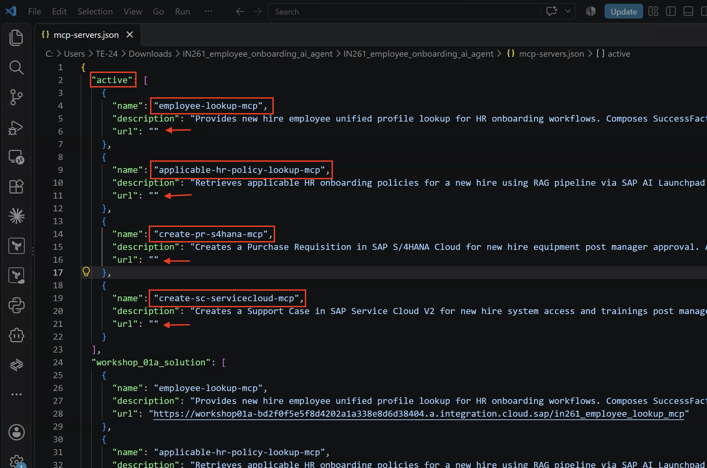

4. Go back to the **Developer Hub** tab you opened in Exercise 6, or in SAP Integration Suite, click the **grid icon (⠿)** in the top-right navigation bar and select **Developer Hub**.

   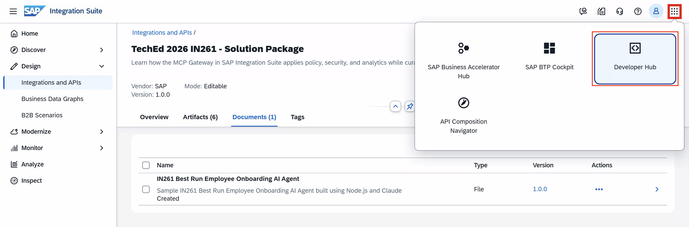

5. In the Developer Hub search bar, type **`IN261_0** Employee Onboarding`** (replace ** with your assigned participant number) and click the search icon.

   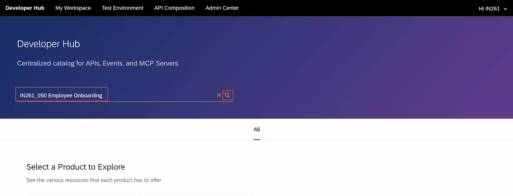

6. Under the **Products** tab in the search results, click on **`IN261_0** Employee Onboarding`** to open it.

   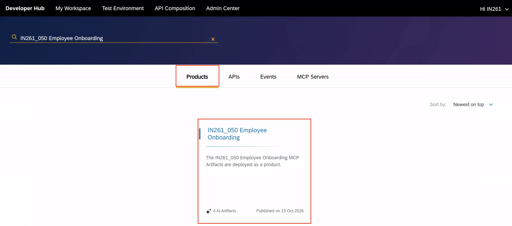

7. Click the **AI Artifacts** tab. You will see all four deployed MCP Servers in your product.

   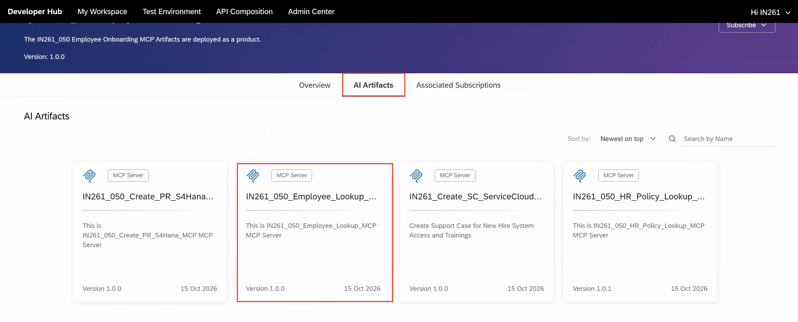

8. Click on **`IN261_0**_Employee_Lookup_MCP`** to open it. On the **Overview** page, locate the **MCP Server URL** field and click the **copy icon** next to it.

   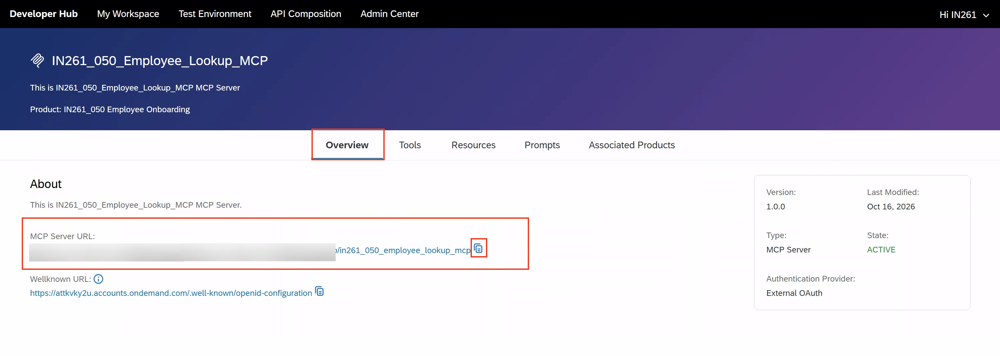

9. Switch back to **`mcp-servers.json`** in VS Code. Paste the copied URL into the **`url`** field of **`"employee-lookup-mcp"`** in the **`active`** section.

   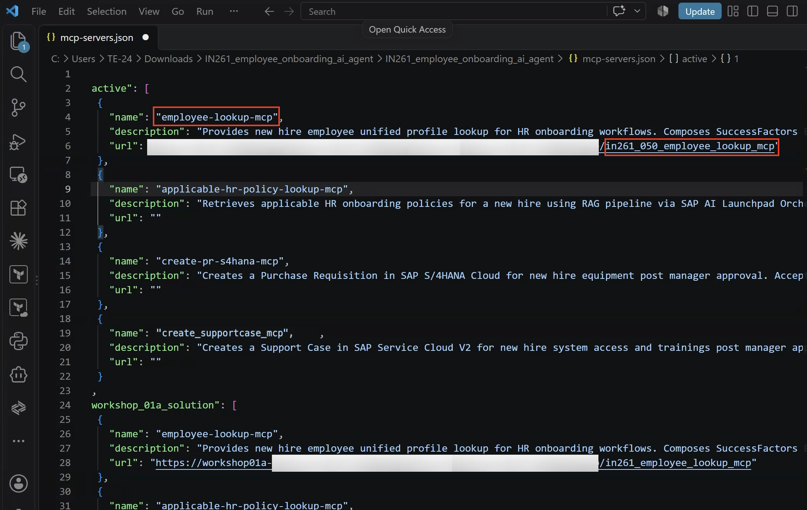

10. Go back to the **AI Artifacts** tab and repeat the same process for the remaining three MCP Servers — click each one, copy its **MCP Server URL**, and paste it into the corresponding entry in the **`active`** section:

      | MCP Artifact in Developer Hub | Entry in **`active`** section |
      |---|---|
      | **`IN261_0**_HR_Policy_Lookup_MCP`** | **`"applicable-hr-policy-lookup-mcp"`** |
      | **`IN261_0**_Create_PR_S4Hana_MCP`** | **`"create-pr-s4hana-mcp"`** |
      | **`IN261_0**Create_SupportCase_MCP`** | **`"create-supportcase-mcp"`** |

   > [!IMPORTANT]
   > Each MCP Server URL must be pasted into the **exact matching `name` entry** in the **`active`** section. Pasting a URL into the wrong entry will cause the agent to call the wrong server and fail at runtime. Double-check the **`name`** field before saving.

   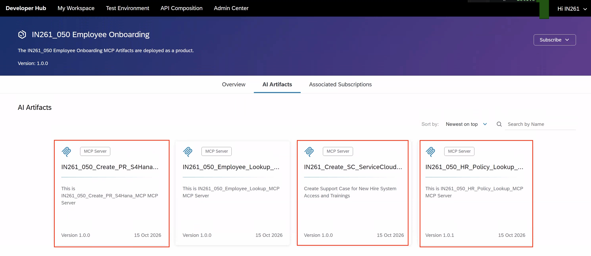

11. Once all four **`url`** fields are filled in the **`active`** section, **save the file** (`Ctrl + S`).

    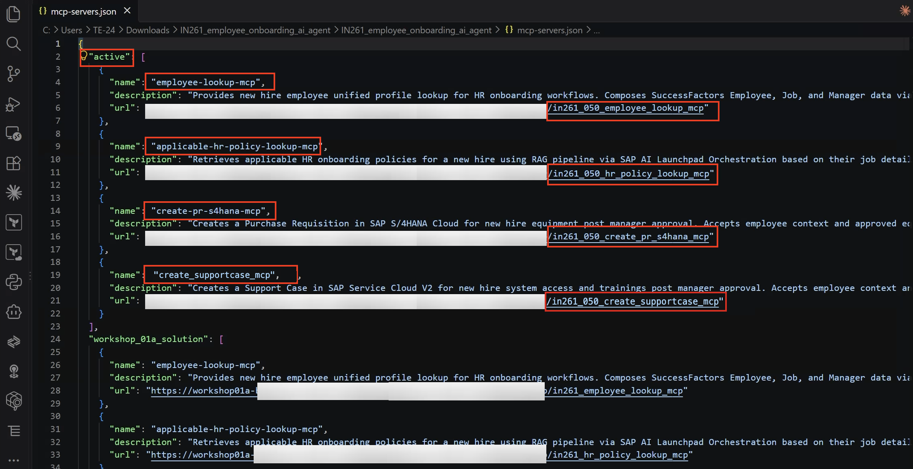

12. After saving, go back to the **`IN261_employee_onboarding_ai_agent`** folder in File Explorer — you will open a terminal from here in the next step.

    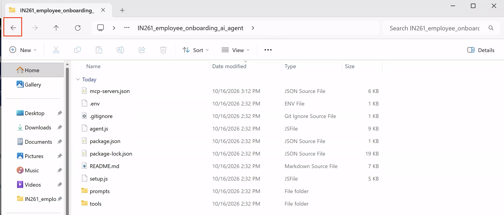

## Exercise 7.3 — Install Dependencies and Run Setup

### Step 1: Open a Terminal

In File Explorer, right-click on the **`IN261_employee_onboarding_ai_agent`** folder and select **Open in Terminal**.

   <br>

### Step 2: Verify Node.js and Install Dependencies

In the terminal, run the following commands:

```bash
node -v
```

This confirms Node.js is installed. The version shown is fine — **do not update Node.js or npm**.

```bash
npm install
```

This installs all required dependencies. You may see a deprecation warning (`npm warn deprecated node-domexception`) — this is expected and can be safely ignored.

> [!IMPORTANT]
> Do **not** run `npm install -g` or attempt to update npm. Doing so will break the installed dependencies.

   <br>

### Step 3: Run Setup

```bash
node setup.js
```

The setup wizard will ask you two things:

1. **Workshop tenant** — enter `1` for **workshop 01a** or `2` for **workshop 01b**, as assigned by your instructor
2. **AEM Queue name** — enter your assigned queue in the format `IN261_0**` (replace `**` with your participant number, e.g. `IN261_050`)

Once complete, you will see:

```
Setup complete! Run 'node agent.js' to start the agent.
```

   <br>

## Exercise 7.4 — Run the Agent

```bash
node agent.js
```

Your browser will open automatically for SAP IAS login. Log in with your workshop credentials.

   <br>

Once login is complete, the browser displays:

> *"Login successful! You can close this tab and return to the Employee Onboarding AI Agent Terminal."*

Close this browser tab and return to the terminal.

   <br>

Back in the terminal, the agent connects to all four MCP Servers and subscribes to your AEM queue. Once you see the following lines, the agent is ready:

```
AEM Connected via AMQP to VPN: teched2026-in261
AEM Subscribed to queue: IN261_050
AEM Waiting for new hire events from SuccessFactors...
```

   <br>

> [!NOTE]
> Keep the terminal open and the agent running — you will need it in Exercise 8, where your instructor will trigger a new hire event and the agent will orchestrate the full onboarding workflow.

## Summary

You have now set up and started the Employee Onboarding AI Agent.

- The agent bundle was downloaded from the **TechEd 2026 IN261 - Solution Package** in SAP Integration Suite
- The four MCP Server URLs from your published Developer Hub product are configured in `mcp-servers.json`
- `node setup.js` set the correct workshop tenant and connected the agent to your AEM queue
- The agent is running and authenticated — ready to respond to new hire events

Continue to - [Exercise 8](../ex8/README.md)
