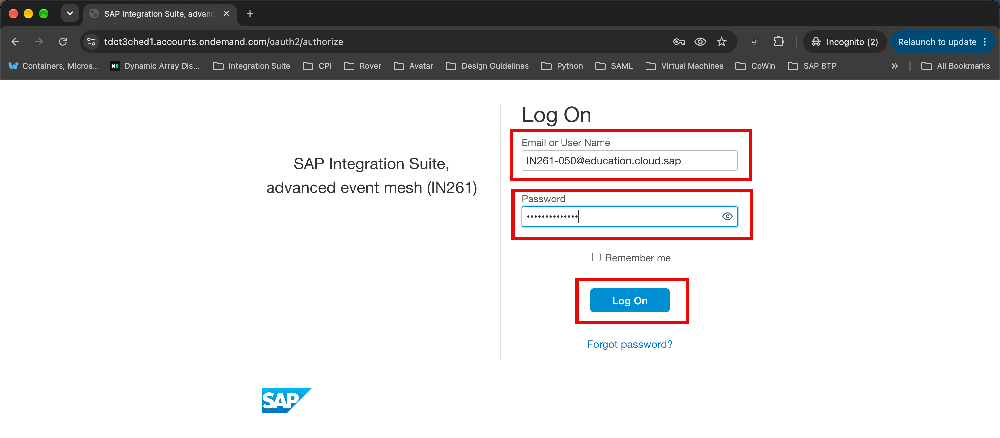
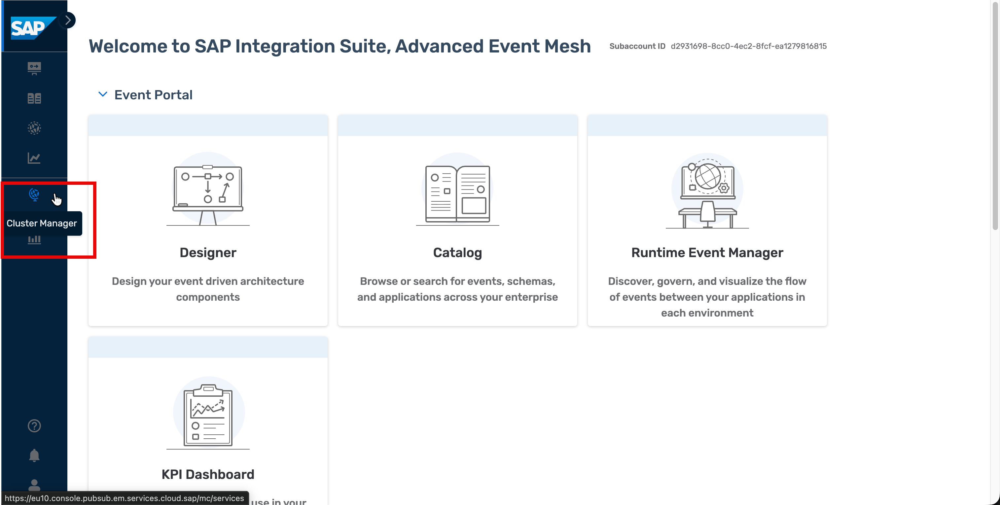
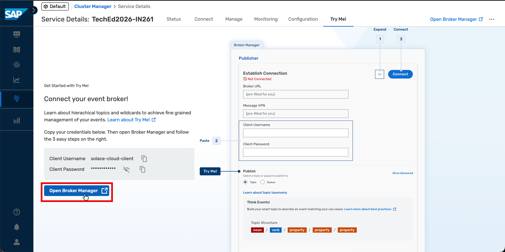
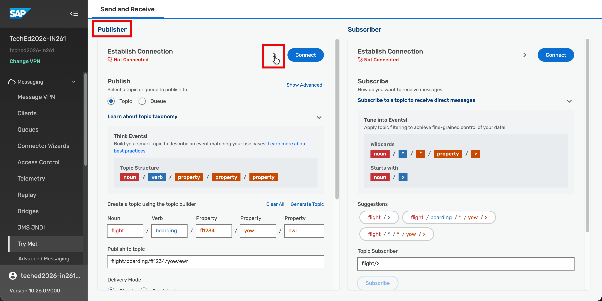
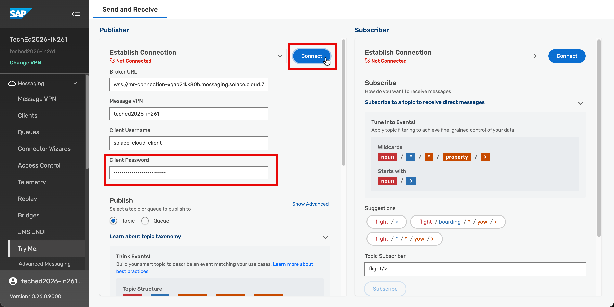
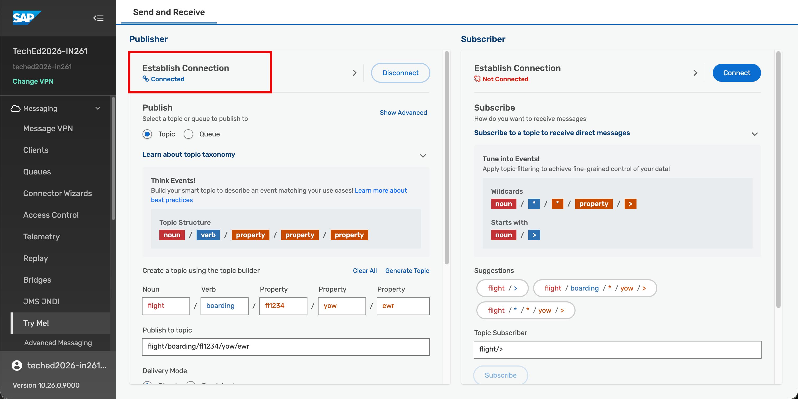
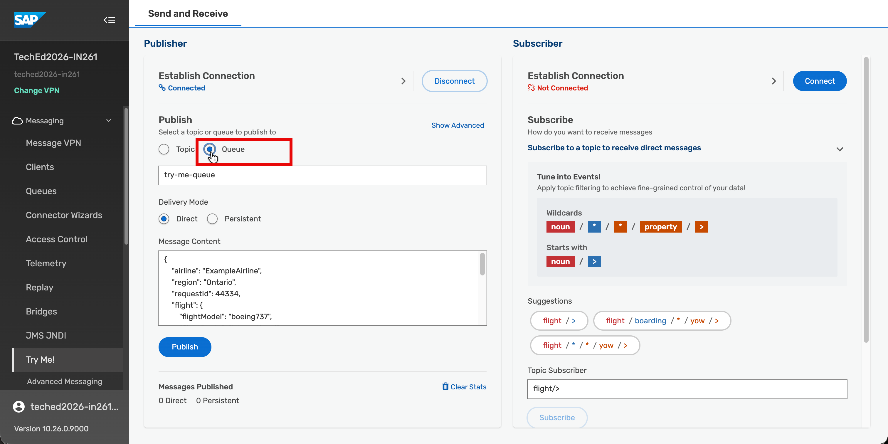
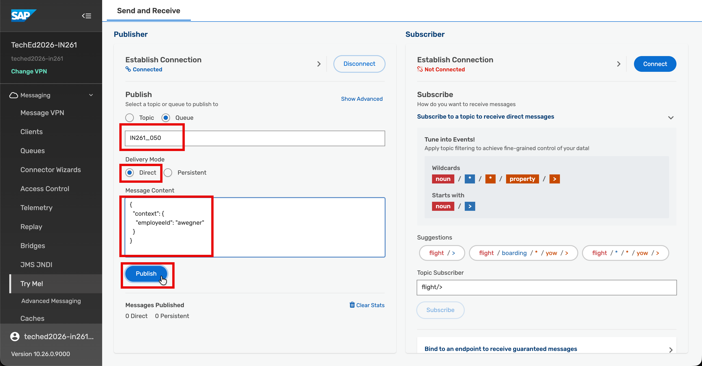
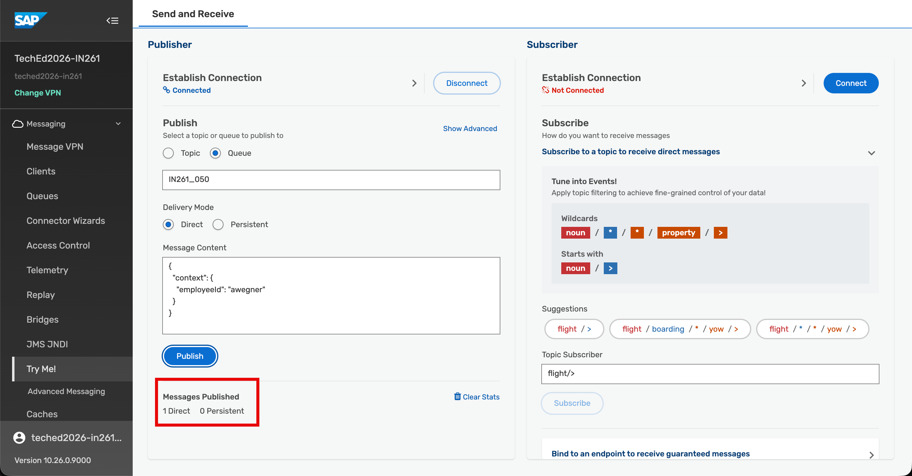

# Exercise 8 — Trigger a New Hire Event
In this exercise, you will trigger a new hire event that your agent is waiting for. Choose the route that works best for you — both result in a **NEWHIRE** event arriving in your AEM queue and your agent starting the onboarding workflow.

⏱ **Estimated time: 10 minutes**

## Overview
Your agent is running and subscribed to your AEM queue — waiting for a **NEWHIRE** event from SAP SuccessFactors. In this exercise, you trigger that event.

There are two routes to choose from:

- **Route 1: Add a New Employee in SAP SuccessFactors** — triggers a real **NEWHIRE** event through the standard SuccessFactors new hire flow. This is the production-realistic path.
- **Route 2: Publish the Event directly from the AEM Try Me! Tool** — uses the AEM Try Me feature to publish a pre-defined **NEWHIRE** event payload directly to your queue.  This is the fallback path if you want a faster trigger, or if SAP SuccessFactors is unavailable or has some issues.

By the end, a **NEWHIRE** event has been published to your AEM queue and your agent has received it — the onboarding workflow has begun.

> [!NOTE]
> Ensure your agent from [Exercise 7](../ex7/README.md) is still running in the terminal before proceeding. If the terminal was closed, re-run **`node agent.js`** from the **`IN261_employee_onboarding_ai_agent`** folder.

## Exercise 8.1 — Choose your Route and Trigger the Event

<details>
<summary><strong>Route 1 — Add a New Employee in SAP SuccessFactors</strong></summary>
...steps...
</details>

**or**

<details>
<summary><strong>Route 2 —  Publish the Event directly from the AEM Try Me! Tool</strong></summary>

1. Log on to [AEM](https://url.sap/hu5r93) tenant using the user ID and password that is already provided by the instructors.
   For login, use the participant number that is assigned to you.
   

2. Click **`Cluster Manager`** in the left navigation menu on the landing page.

   
   
3. In the **`Cluster Manager: Services`** screen, click on the **`TechEd2026-IN261`** tile.
   >**HINT:** If you cannot see the tile, uncheck the **`Only show my services`** checkbox.

	

4. Switch to the **`Try Me!`** tab.
	
	

5. To connect to the event broker, **copy** the **`Client Password`**.

   

6. Once you copy the Client Password, click on **`Open Broker Manager`** button.

   
   
7. A new browser tab will open. Click on the **expand** **`>`** **Icon** under **`Publisher`** section to show the connection details.

    

8. Paste the copied client password from step 5 into the **`Client Password`** field and click on the **"Connect"** button.

    

9. You will see the **`Connected`** text appear unders the **`Publisher`** section.
     

10. Choose **`Queue`** radio button.
     

11. Enter **`IN261_0**`** as the Queue name (replace ** with your assigned participant number, e.g. `IN261_050`) — the same queue you created in Exercise 1. Change **`Delivery Mode`** to **`Direct`**.

12.  Choose an employee from the table below and copy their Employee ID — the HR Policy Lookup MCP will return different equipment, system access, and training requirements based on the employee's role and department:

		| Employee ID | Employee Name | Role | Department |
		|---|---|---|---|
		| `asingh1` | Atif Singh | Engineer | Research & Development (RND) |
		| `smilano1` | Susan Milano | Engineer | Research & Development (RND) |
		| `bchrist1` | Barry Chen | Sales Manager | Sales (SALES) |
		| `hfitch1` | Henry Fitch | Senior Sales Manager | Sales (SALES) |
		| `bgonzalez1` | Brian Gonzalez | Marketing Manager | Marketing (MKTG) |
		| `sshue1` | Susan Shue | Marketing Manager | Marketing (MKTG) |
		| `pseliger1` |Patrick Seliger | Director, Manufacturing | Operations (OPS) |
		| `jbowman1` | Jeff Bowman | Plant Manager | Plant Operations (OPS-PLNT) |

		Add the following **`Message Content`**, replacing the **employeeId** with the ID you chose:
		```json
		{
		  "context": {
		    "employeeId": "<replace with employee id of your choice from the table above>"
		  }
		}
		```

    	Click **"Publish"** to send your message to the queue.
	
    	 

13. You see under **`Messages Published`** that 1 Direct message has been published successfully.

	> **💡 Direct message is delivered immediately to any active consumer (your running agent). If the consumer is not connected at the moment of publishing, the message is lost. No guarantee of delivery, so make sure your agent is running else run the agent and publish it again or change the Delivery Mode to Persistent.**

	 

</details>

## Summary
You have triggered the new hire onboarding workflow. Your agent has received the **NEWHIRE** event using the **SAP Advanced Event Mesh** and has begun orchestrating the onboarding process.

Continue to - [Exercise 9 — Observe, Approve, and Verify the AI-Orchestrated Onboarding Workflow](../ex9/README.md) to:

- Observe the agent call MCP tools in real time in the terminal
- Review and approve the onboarding plan as the hiring manager
- Verify the Purchase Requisition created in SAP S/4HANA
- Verify the Support Case created in SAP Service Cloud V2
- Trace the end-to-end flow via SAP SuccessFactors OData API audit logs
- Monitor MCP tool call analytics and health in SAP Integration Suite
