# Exercise 9 — Observe, Approve, and Verify the AI-Orchestrated Onboarding Workflow
Everything you built across this session comes together here — watch it work.
In this exercise, you will observe the employee onboarding AI agent orchestrate the full onboarding workflow in real time, approve the plan as the hiring manager, and verify the outcomes.

⏱ **Estimated time: 15 minutes**

## Overview
Across Exercises 1 through 8, you deployed four MCP Servers, published them as a governed product in the Developer Hub, and started the Employee Onboarding AI Agent — all routed through the **SAP Integration Suite MCP Gateway** with authentication, authorization, and audit logging at every step.

Now you see the result. The agent receives the **NEWHIRE** event from **SAP Advanced Event Mesh**, calls your MCP tools to fetch the new hire profile and retrieve applicable HR policies, and structures everything into a complete onboarding plan — then pauses and waits for you.

This is the **human-in-the-loop** gate. No Purchase Requisition is raised in SAP S/4HANA, no Support Case is opened in SAP Service Cloud V2, until you explicitly approve. Once you **approve**, the agent calls the **Create PR S/4HANA MCP to raise a Purchase Requisition for the new hire's equipment** and the **Create Support Case MCP to open a Service Cloud case for IT system access and training enrollment**.

You then verify both outcomes, directly in **SAP S/4HANA and SAP Service Cloud V2**. Trace every API call back to your identity in the **SAP SuccessFactors OData API Audit Log,** and review MCP tool call analytics in SAP Integration Suite — confirming the full governance story end to end.

By the end, you have not just seen an AI agent work — you have seen it work safely, traceably, and with a human in control.

> [!NOTE]
> This exercise continues directly from [Exercise 8](../ex8/README.md). Your agent terminal must be open and the new hire event must have been triggered before proceeding.

## Exercise 9.1 — Observe the Agent Orchestrate the Workflow
In this sub-exercise, you watch the agent process the new hire event step by step in the terminal — receiving the event, calling MCP tools, and building the full onboarding plan.

### Step 1: New Hire Event Received

The terminal confirms that the AEM message has arrived from SAP SuccessFactors. The employee ID is extracted from the event payload and the agent begins processing.

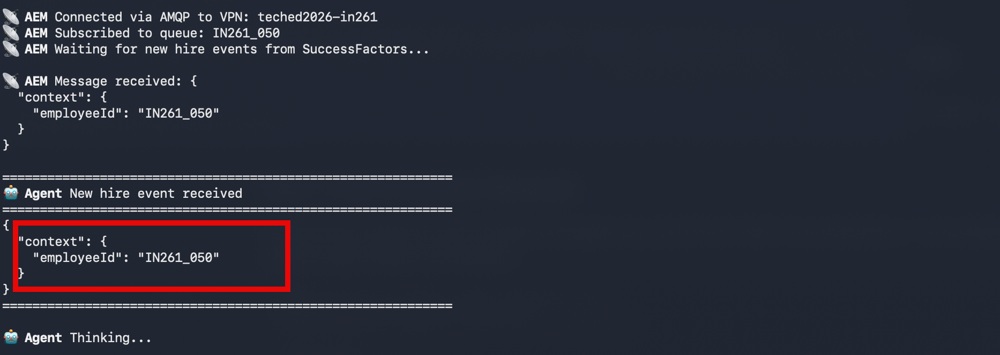

### Step 2: Agent Calls MCP Tools

The agent makes three tool calls in sequence:

1. **`get_bestrun_hcm_employee`** (via Employee Lookup MCP) — fetches the new hire's personal details from SAP SuccessFactors
2. **`get_bestrun_hcm_employeeJob`** (via Employee Lookup MCP) — fetches job title, department, manager, business unit, and location
3. **`post_newhire_applicable_hr_policy`** (via HR Policy Lookup MCP) — sends the employee context to the RAG-grounded policy engine and retrieves the applicable equipment list, system access entitlements, and training requirements

All three calls are routed through the SAP Integration Suite MCP Gateway, authenticated with your identity token.

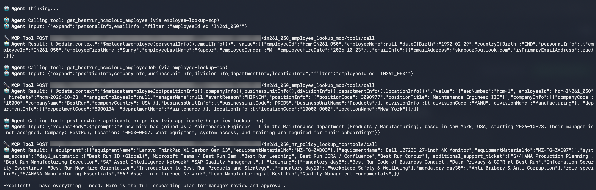

### Step 3: Onboarding Plan Presented

The agent structures all retrieved data into a full onboarding plan and presents it in the terminal. The plan opens with a **New Hire Summary** and the **Equipment Provisioning** list — items that will be ordered via a Purchase Requisition in SAP S/4HANA.

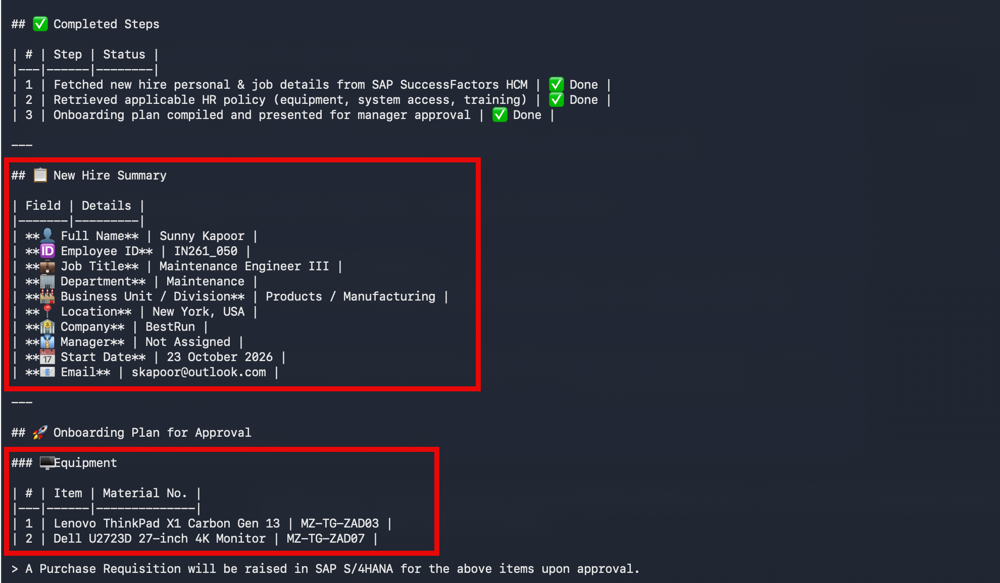

Scrolling down, the plan continues with the **System Access** section — Day 1 auto-provisioned systems and additional systems that require a Service Cloud support case to be raised.

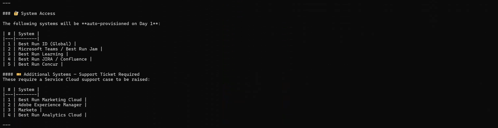

Finally, the **Training Schedule** lists mandatory courses by day 5, 10, and 30, plus role-specific training that also requires a Service Cloud support case.

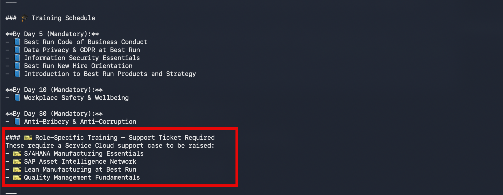

## Exercise 9.2 — Approve the Onboarding Plan
In this sub-exercise, you act as the hiring manager and approve the onboarding plan. This is the **human-in-the-loop** gate — the agent has paused and is waiting for your explicit response before taking any action in backend systems.

### Step 1: Review the Approval Prompt

After presenting the full plan, the agent addresses the manager directly and waits for a response. No backend action has been taken yet.

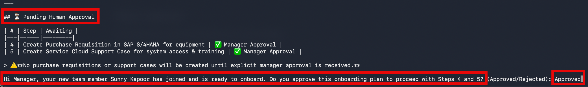

### Step 2: Approve

In the terminal, type the following and press **Enter**:

```
Approved
```

> [!NOTE]
> The agent will not proceed until you explicitly approve. If you type anything other than `Approved`, the agent will treat it as a rejection and stop the workflow.

### Step 3: Agent Creates the Purchase Requisition and Support Case

Immediately after your approval, the agent calls the two remaining MCP tools:

1. **`post_newhire_equipments`** (via Create PR S/4HANA MCP) — creates a Purchase Requisition in SAP S/4HANA for the new hire's equipment and returns the PR number and a direct link
2. **`post_sap_c4c_api_v1_case_service_cases`** (via Create SC Service Cloud MCP) — creates a Support Case in SAP Service Cloud V2 for system access and training assignment and returns the case ID and a direct link

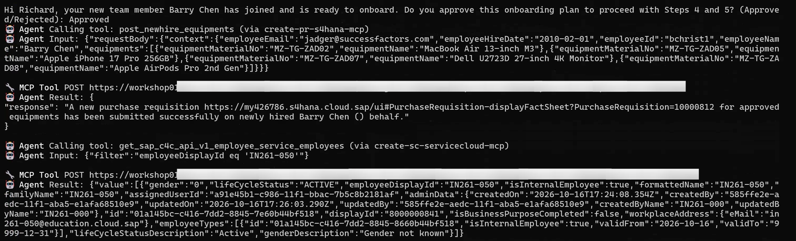

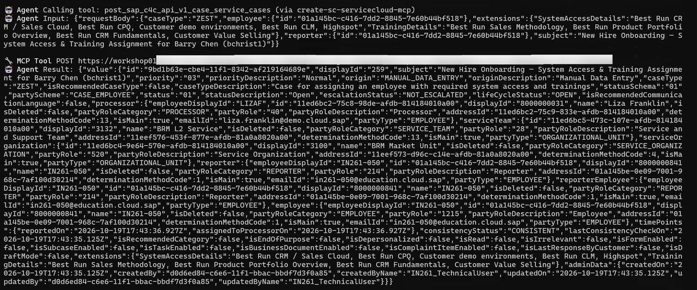

### Step 4: Review the Onboarding Summary

Once both actions complete, the agent prints a full **Onboarding Summary** in the terminal — a structured table for each outcome with the PR number, Case ID, and a direct link to each record.

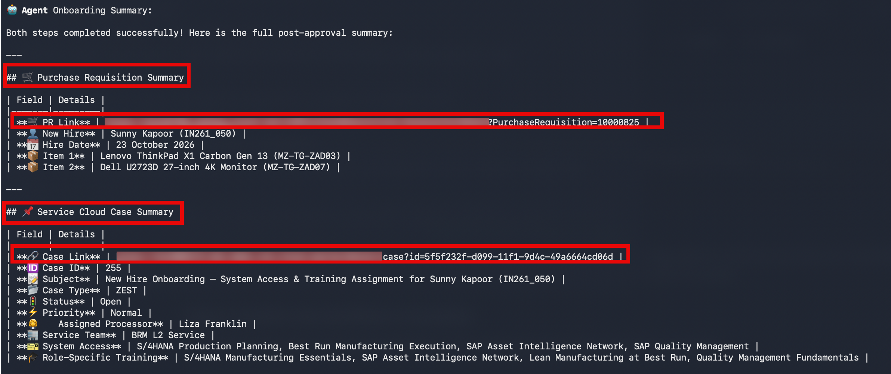

> [!IMPORTANT]
> The summary contains two clickable links — the **PR Link** for SAP S/4HANA and the **Case Link** for SAP Service Cloud V2. Hold **Ctrl** and click each link to open it in your browser. You will use these links in Exercise 9.3 to verify the results.

### Step 5: Confirm the Workflow is Complete

The agent closes with a final **Completed Steps** table confirming all five steps finished successfully.

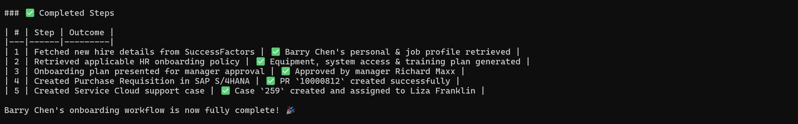

## Exercise 9.3 — Verify the Results

With both backend records created, you will now open each one directly from the links in the Onboarding Summary and verify the details.

### Step 1: Open the created Purchase Requisition in SAP S/4HANA system

1. In the terminal, **Ctrl+Click** the **PR Link** from the Onboarding Summary. Your browser will open the SAP S/4HANA login page.

2. Log in with your workshop credentials:
   - **User Name:** **`IN261-0**`** *(replace XX with your assigned participant number)*
   - **Password:** *will be shared by the instructors*

   Click **Continue**.

   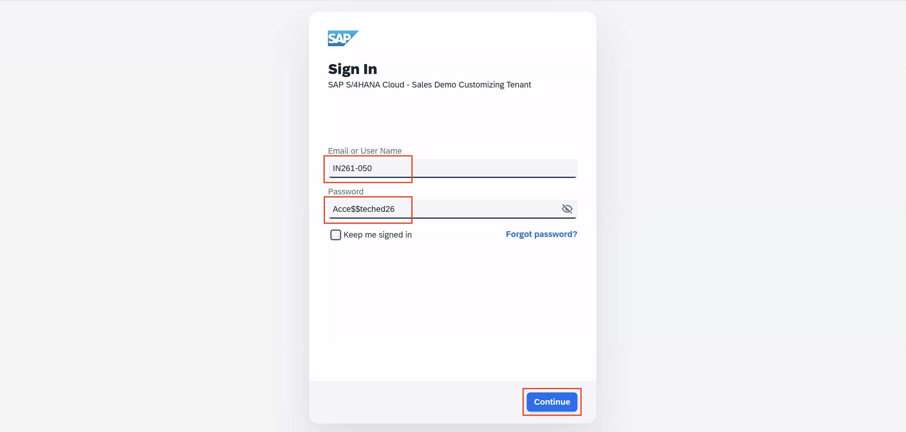

3. After login, the Purchase Requisition opens directly. Verify the **General Information** tab — PR number, employee name, number of items, and total value.

   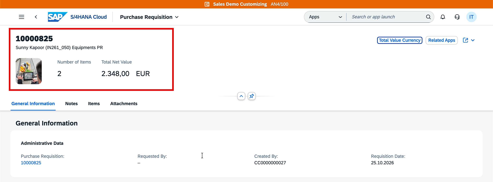

4. Click the **Items** tab to see the individual equipment lines ordered for the new hire.

   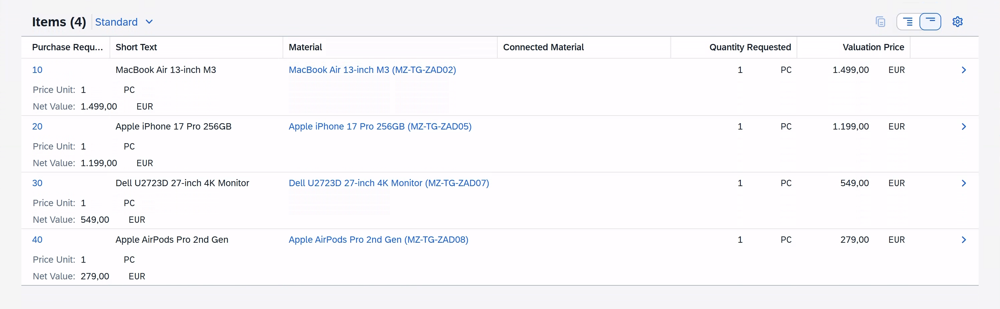

### Step 2: Open the created Support Case in SAP Service Cloud V2 system

1. Return to the terminal and **Ctrl+Click** the **Case Link** from the Onboarding Summary. Your browser will open the **SAP Service Cloud V2** login page.

2. Click **Sign in using SSO**.

   

3. On the IAS login page, enter your workshop credentials:
   - **User Name:** **`IN261-0**`** *(replace ** with your assigned participant number)*
   - **Password:** *will be shared by the instructors*

   Click **Continue**.

   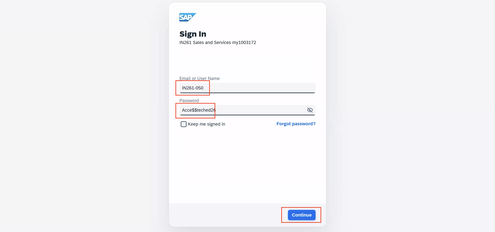

4. The Support Case opens. Verify the case details in the **`Submitted`** tab of the case flow.

   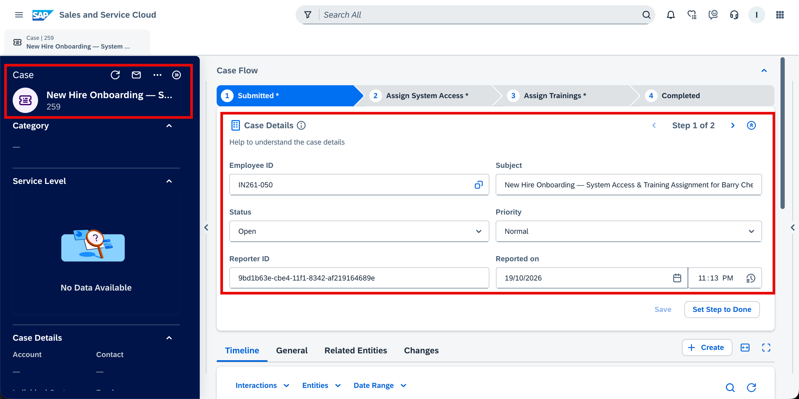

5. Click on the **`Assign System Access`** tab to see the **`System Access Details`**.

   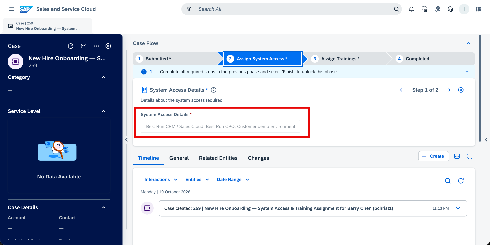

6. Click the **`Assign Trainings`** tab to see the **`Training Details`**.

   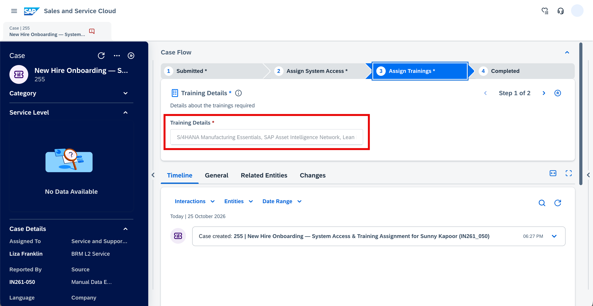

### Step 3: Open the OData API Audit Log in SAP SuccessFactors to see the end-to-end traceability

1. Log on to [SAP SuccessFactors](https://url.sap/1ubd08) with your workshop credentials.

   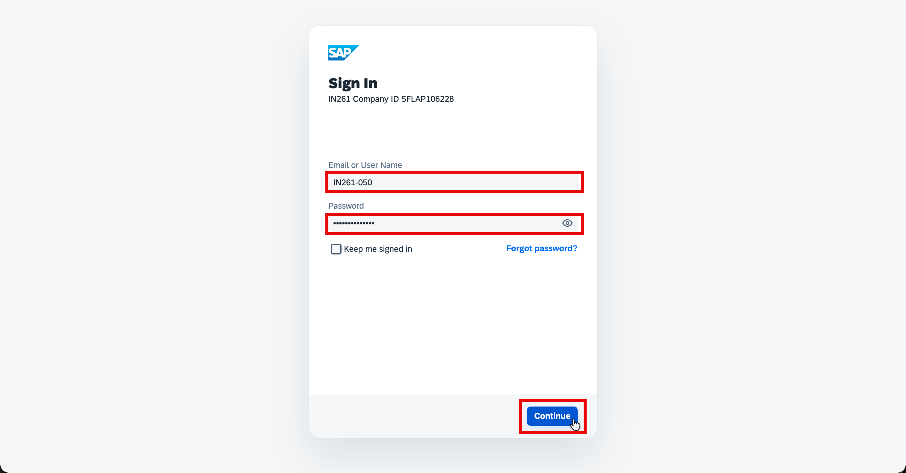

2. In the top-right corner, click the **profile icon** and select **`Admin Center`**.

    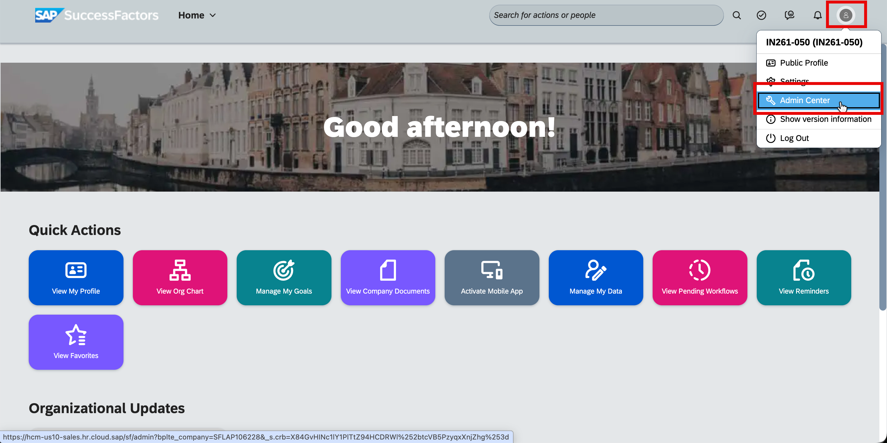

3. In the **`Admin Center`** search bar, type **`OData API Audit Log`** and click on it to open it.

   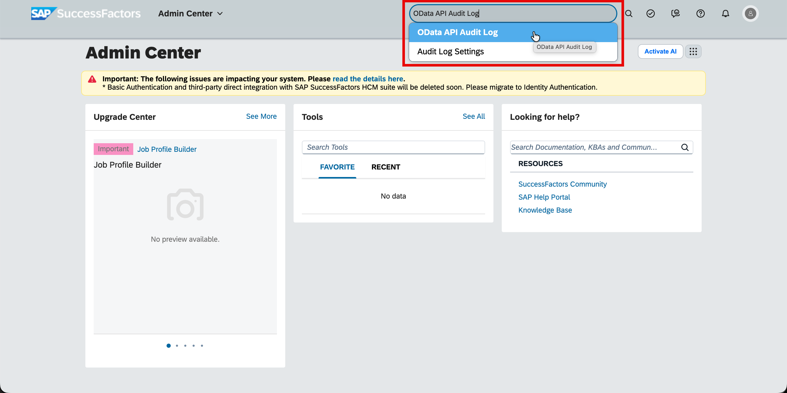

4. You will see entries for the **`Query`** API calls made by the agent to the Employee and EmployeeJob entities — timestamped to the moment your agent ran. Each entry confirms the exact API call, the user identity i.e. **`IN261-0**`** *(replace ** with your assigned participant number)* it was made under, and the entity accessed.
 
   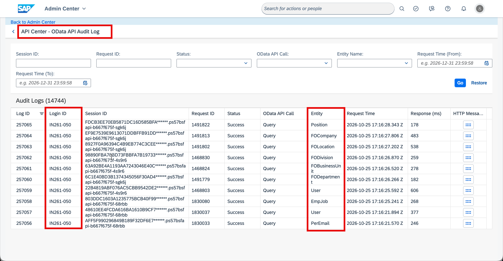
   
> [!NOTE]
> This is **Principal Propagation** in action — the agent called the MCP tool, the MCP Gateway forwarded the request with your identity token, and SuccessFactors logged it against your user — not a technical service account.

## Exercise 9.4 — View MCP Analytics in SAP Integration Suite

Every tool call made by the agent was routed through the SAP Integration Suite MCP Gateway — authenticated, authorized, logged, and traceable. In this sub-exercise, you verify that your MCP Servers are running and explore the analytics dashboard to see call volumes, response times, and error patterns for your MCP tools.

### Step 1: Navigate to Monitor

1. In SAP Integration Suite, navigate to **Monitor → Integrations and APIs** in the left navigation.

   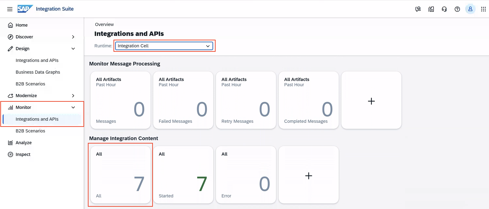

2. Under **Manage Integration Content**, you will see all deployed MCP Servers with their runtime status. Confirm that all your MCP Servers show **Started** and that the **Error** count is **0**.

### Step 2: Navigate to Analyze

1. In the left navigation, click **Analyze**.
2. Set the filters at the top of the page:
   - **Runtime:** `Integration Cell`
   - **Artifact Type:** `MCP Server`

   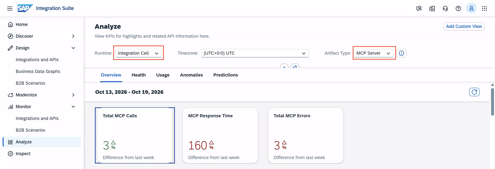

3. The **Overview** tab shows three KPIs for the selected period — **Total MCP Calls**, **MCP Response Time**, and **Total MCP Errors** — giving you a health snapshot of all MCP activity across your tenant.

### Step 3: Explore MCP Call Charts

Scroll down the Overview page to see the detailed charts.

The **MCP Server Calls** chart shows the daily call count over time — broken down by cumulative, failure, and success.

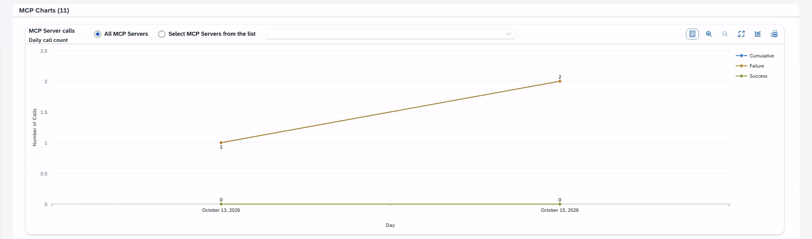

Further down, **Top MCP Servers of the Week** shows which of your MCP Servers received the most calls, and **Top Subscriptions for Agents** shows the agent subscriptions driving that traffic.

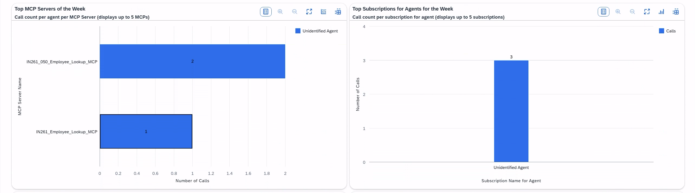

### Step 4: Review the Health Tab

Click the **Health** tab at the top of the Analyze page.

The Health view shows **MCP Server Errors by Tool vs Resource** and the **MCP Policy Errors** heatmap — breaking down which MCP Servers experienced policy-level failures, how many, and when.

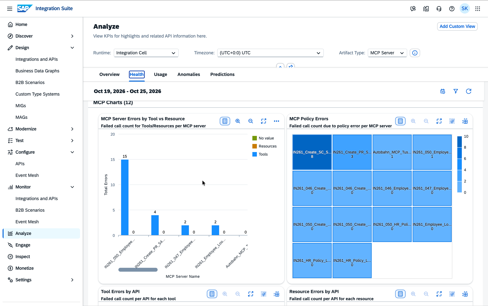

> [!NOTE]
> The analytics dashboard covers all MCP Servers across your tenant — not just the ones called during this workflow. This is the governance and observability layer that makes every agent action auditable and enterprise-ready.

## Summary
You have now successfully completed the full employee onboarding workflow — from a **NEWHIRE** event in SAP SuccessFactors all the way to governed, traceable outcomes across multiple SAP systems, powered by an **AI agentic workflow** built on the **MCP Gateway of SAP Integration Suite**.

Every tool call made by the agent — **fetching employee data via API Composition**, **retrieving HR policy via RAG-grounded AI Launchpad Orchestration**, **creating a Purchase Requisition in SAP S/4HANA**, and **raising a Support Case in SAP Service Cloud V2** — was routed through the **MCP Gateway** with authentication, authorization, and audit logging enforced at every step. 

Your **identity propagated** end to end via **Principal Propagation**, ensuring every action is traceable back to you. And no backend system was touched without your explicit approval — the **human-in-the-loop** gate kept a human in control of every automated decision.

This is what it means to **enable governed access** to **AI agents** in the enterprise: not just connecting agents to systems, but doing so with the security, observability, and control that production workloads demand.

**You have completed all exercises. Well done!** 🎉
